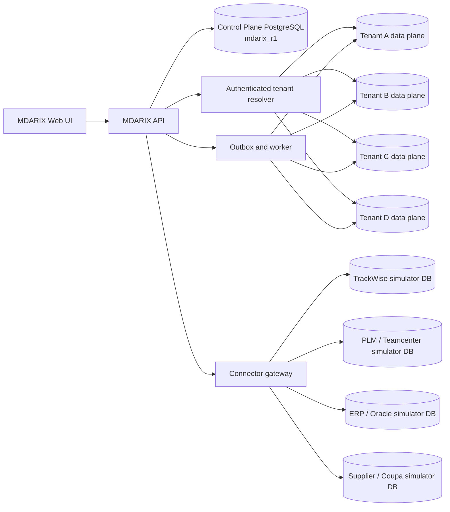

# MDARIX R1 Current Database Architecture

**Status:** Current implementation and MVP validation topology  
**Scope:** Synthetic validation customers; production customer infrastructure is intentionally out of scope for this MVP  
**Last reviewed:** 2026-09-29

## 1. Architecture in plain language

MDARIX uses two database layers:

1. **Control plane** — one PostgreSQL database owned by MDARIX. It stores identity, tenant membership, plans, configuration, mappings, connector registrations, audit records, jobs, and other platform control data.
2. **Customer data planes** — one isolated PostgreSQL database per synthetic customer tenant. These databases store tenant business data such as products, complaints, investigations, evidence, suppliers, lots, provenance, vectors, and data-plane ingestion records.

External provider simulators are separate again. Each simulator has its own PostgreSQL database and exposes an authenticated API. MDARIX reads those APIs; it does not connect directly to simulator tables.



## 2. Database inventory

### 2.1 Control plane

| Item | Current value |
|---|---|
| Engine | PostgreSQL 16 with pgvector image |
| Local container | `mdarix-r1-postgres` |
| Local host port | `5433` |
| Database | `mdarix_r1` |
| Runtime role in current local setup | `mdarix_app` / migration role configuration varies by environment |
| Migration tool | Alembic |
| Migration directory | `infrastructure/database/migrations/versions` |
| Main responsibilities | Authentication, tenant registry, memberships, plans, mappings, integrations, audit, outbox, jobs, and platform administration |

Representative control-plane entities include `tenants`, customer/lifecycle records, users and memberships, subscriptions, configurations, master mappings, connector registrations, connector runs, source-record ledgers, outbox events, audit events, report jobs, AI execution records, MFA records, and governance/signature records.

### 2.2 Synthetic customer data planes

| Tenant | Database | Local service | Host port | API registry key |
|---|---|---|---:|---|
| Tenant A | `mdarix_tenant_a` | `tenant-a-data` | 5541 | `R1_TENANT_1` |
| Tenant B | `mdarix_tenant_b` | `tenant-b-data` | 5542 | `R1_TENANT_2` |
| Tenant C | `mdarix_tenant_c` | `tenant-c-data` | 5543 | `R1_TENANT_3` |
| Tenant D | `mdarix_tenant_d` | `tenant-d-data` | 5544 | `R1_TENANT_4` |

The API resolves a tenant data plane from the authenticated tenant and the durable `tenant_data_planes` registry. A browser request cannot provide a host, database name, or password. In non-development environments, a missing connection secret fails closed.

The data-plane foundation supports tenant-owned business tables and is being expanded service by service. Product, product version, complaint, investigation, evidence, provenance, relationship, vector, report, attachment, and worker routes must continue to use the data-plane dependency; control-plane identity and administration routes must continue to use the control-plane session.

### 2.3 Provider simulator databases

Each provider simulator has a separate PostgreSQL database and service. The simulator API is the integration boundary.

| Provider family | Service/API port | Database service | Database |
|---|---:|---|---|
| TrackWise | 8101 | `trackwise-simulator-db` | `trackwise` |
| PLM | 8102 | `plm-simulator-db` | `plm` |
| ERP | 8103 | `erp-simulator-db` | `erp` |
| Supplier | 8104 | `supplier-simulator-db` | `supplier` |
| Veeva QMS | 8105 | `veeva-qms-simulator-db` | `veeva_qms` |
| Siemens Teamcenter | 8106 | `teamcenter-simulator-db` | `teamcenter` |
| Oracle Fusion ERP | 8107 | `oracle-erp-simulator-db` | `oracle_erp` |
| Coupa | 8108 | `coupa-simulator-db` | `coupa` |

Provider databases are not MDARIX databases. They contain synthetic source records, source-record history, provider identity, and tenant-keyed simulator data. MDARIX receives data through the provider API and records a durable connector run/source-record/outbox boundary.

## 3. Tenant and isolation rules

- Control-plane tenant identity is derived from the authenticated session.
- Data-plane connection selection is server-side and registry-driven.
- Business rows carry `tenant_id` and use tenant-safe foreign-key relationships where applicable.
- Local PostgreSQL RLS and application authorization provide defense in depth.
- Provider APIs require `X-Provider-Token` and verify the token’s tenant scope against the optional `tenant` query parameter.
- Search, export, AI context, attachments, reports, ingestion, and workers must preserve the same tenant boundary.
- Authentication/bootstrap tables are intentionally used to establish tenant context and remain protected by application authorization rather than relying only on RLS.

## 4. Connector API contract

Every connector follows the same logical contract even when the customer’s real API differs:

| Capability | Simulator route/behavior |
|---|---|
| Health | `GET /health` and `GET /ready` |
| Schema | `GET /schema/{entity}` |
| Read records | `GET /records/{entity}` with `tenant`, `limit`, cursor/incremental parameters as supported |
| Record history | `GET /records/{entity}/{external_id}/history` |
| Test/write source record | `POST /records/{entity}` with external ID and record version |
| Authentication | `X-Provider-Token` |
| Tenant scope | Token-bound `TENANT_A` through `TENANT_D` |
| Replay/idempotency | Stable external ID, record version, payload fingerprint, and MDARIX idempotency key |
| Failure handling | HTTP/authentication, rate-limit, timeout, schema, retry, and dead-letter categories |

The provider catalog defines one-to-one source-to-canonical field mappings for TrackWise, PLM, ERP, Supplier, Veeva QMS, Teamcenter, Oracle ERP, and Coupa.

## 5. Ingestion flow

1. MDARIX resolves the tenant from the authenticated request.
2. The connector resolves the approved provider endpoint and credential reference.
3. MDARIX calls health/schema before reading records.
4. Records are fetched in bounded pages with retry and cursor/incremental state.
5. Schema fingerprints are compared with the pinned mapping contract.
6. A connector run and source-record ledger entry are written durably.
7. Duplicate records are recognized by tenant, provider, entity, external ID, version, and payload fingerprint.
8. Accepted records create outbox events.
9. The worker claims and processes events with retry/dead-letter behavior.
10. Canonical business records are written to the correct tenant data plane.
11. Provenance, mapping version, source identity, and ingestion timestamps remain attached to the record.

## 6. Backup and operational boundary for MVP

The MVP uses local Docker PostgreSQL volumes and local validation backups. Production TLS, KMS, encrypted backup storage, WAL/PITR, hosted monitoring, and multi-instance deployment are deferred production gates. They must not be represented as completed by this document.

## 7. Required configuration

Local data-plane secrets are named by registry reference, for example:

```text
MDARIX_DATA_PLANE_R1_TENANT_1_DATABASE_URL
MDARIX_DATA_PLANE_R1_TENANT_2_DATABASE_URL
MDARIX_DATA_PLANE_R1_TENANT_3_DATABASE_URL
MDARIX_DATA_PLANE_R1_TENANT_4_DATABASE_URL
```

Provider endpoints and credentials must be configured through connector records or environment-specific secret references. Do not put customer credentials in source control or in mapping definitions.

## 8. Current implementation status

### Implemented foundation

- Control-plane PostgreSQL and Alembic migrations.
- Four isolated synthetic customer data-plane services.
- Eight isolated provider simulator databases/services.
- Server-side tenant data-plane resolution.
- Provider authentication and tenant-scope checks.
- Provider schema/read/history/write contract.
- Mapping catalog and idempotency primitives.
- Connector run/source-record/outbox persistence foundations.

### Next connector API work

- Use the common provider transport for all eight provider families.
- Persist health, schema fingerprint, cursor, retry, and error state per connector run.
- Add route-level connector read/health/schema endpoints for authenticated Platform Admin use.
- Route ingestion writes through the selected tenant data plane.
- Add contract tests for all eight providers and Tenant A–D scope denial.

### Explicitly deferred

- Real customer endpoints and credentials.
- Customer-specific production schemas.
- Hosted production database TLS, KMS, backup/PITR, and monitoring.
- Production multi-instance worker validation.
