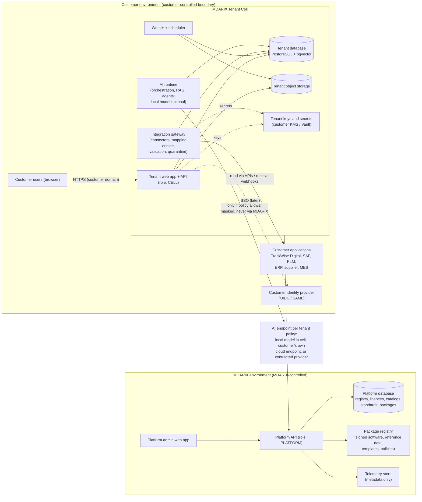
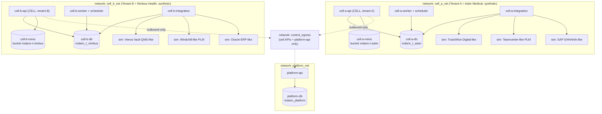
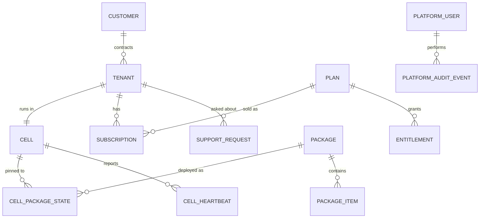
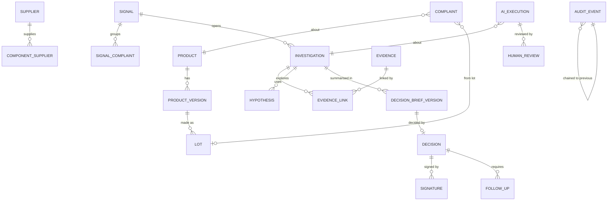
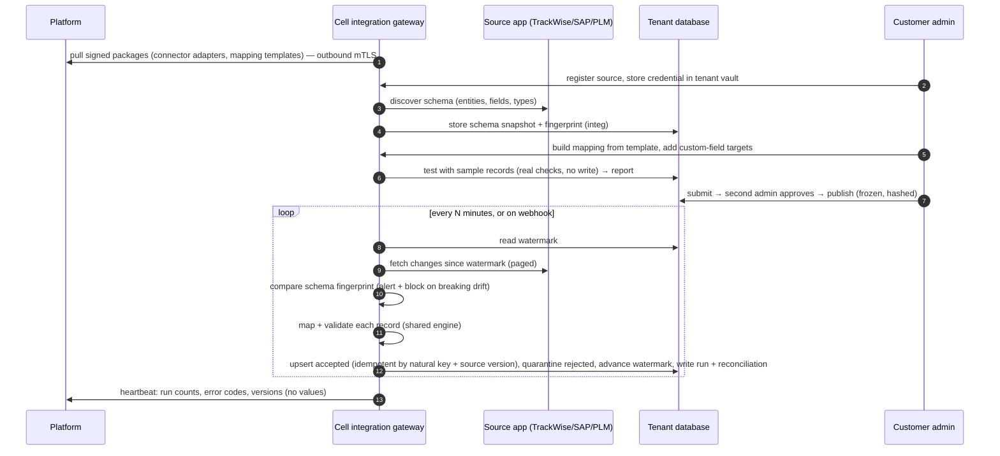

# MDARIX target architecture: customer-controlled, multi-tenant data architecture

| | |
|---|---|
| Status | **Proposal for approval.** No code or database has been changed for this design. |
| Date | 2026-10-08 |
| Code reviewed | `main` at `c57e2d9`, plus unmerged branches `mvp/docs-refresh`, `mvp/import-options`, `mvp/p2-hardening` |
| Evidence | Six read-only code reviews (tenant databases, integration layer, data residency, test evidence, mapping workflow, custom fields and master data), each finding re-checked in code; the CI run that merged PR #2. Details and file references for current-state findings: `docs/architecture/MVP1_PRODUCTION_DATABASE_ARCHITECTURE_REVIEW.md` |
| Labels for current state | **Implemented** (code + test), **Partial** (code exists, incomplete or untested for this purpose), **Missing**, **Unverified** |

---

## 0. Executive summary

**Your proposal is directionally right but incomplete in one decisive way.** It separates *where data is stored* (a customer tenant database) from *where data is processed* (a central MDARIX application). But a central application that reads a customer database still pulls every record it processes into MDARIX-controlled memory, logs, caches, temporary files and AI calls, and anyone who administers that central infrastructure can read it. Logical separation of storage is not access prevention. **To keep confidential data under customer control, the services that process it must sit inside the same boundary as the data.**

**Recommendation: a "control plane + tenant cell" architecture (Option C), built so the same tenant cell can run in three places.**

- **MDARIX Platform (control plane)**, hosted by MDARIX: tenant registry, subscriptions and licences, platform administration, standard models, reference catalogs, mapping templates, connector and AI model catalogs, policies, software releases, and non-sensitive health telemetry. It holds **no customer business data and no customer user directory**.
- **MDARIX Tenant Cell (data plane)**, one per customer: the tenant database, tenant object storage, tenant key and secret store, and the MDARIX services that touch customer data (the tenant application API and web app, integration gateway and mapping engine, workers and scheduler, AI runtime and vector index). Everything customer-confidential is created, processed, stored, logged and backed up inside the cell.
- **One codebase, two runtime roles** (`PLATFORM`, `CELL`), so no customer-specific forks and no microservice sprawl. The cell is the existing backend running in single-tenant mode against its own database.
- **Three hosting modes for the same cell artifact**:
  - **MDARIX-managed dedicated cell**: per-customer isolated environment run by MDARIX. Used for MVP, demonstrations and smaller customers.
  - **Customer-cloud cell**: in the customer's cloud account (AWS, Azure, GCP). The enterprise default.
  - **Customer on-premises / private cell**: later, for customers that require it (Option D).

The cell talks to the platform **outbound only**: it pulls signed packages (software, reference data, templates, policies) and pushes metadata-only heartbeats. The platform never connects into a cell, holds no credential for a tenant database, and has no route that returns customer records. MDARIX staff reach customer data only through a **customer-approved, time-boxed support grant issued and audited by the cell**.

**For MVP 1.0:** adopt the cell architecture now, prove it with two isolated local cells (Tenant A and Tenant B) and an automated isolation and boundary test suite in CI, then run design partners in MDARIX-managed dedicated cells, or customer-cloud cells where a partner requires it. Today's code already has most of the business model, per-tenant database routing, forced row-level security and audit chain needed. The main changes are moving the remaining customer data out of the central database, splitting the runtime roles, adding the control-to-cell protocol, per-tenant storage and keys, and the integration runner inside the cell (section 13).

**Decision: freeze the twelve decisions in section 15.12 before further MVP feature work.** Most current rework risk comes from building more features on the current central-database assumption.

---

## 1. Recommended architecture decision

### 1.1 Critical evaluation of the proposed two-environment model

| Proposal element | Assessment |
|---|---|
| Central platform holds standards, catalogs, provisioning, licences, releases | **Correct.** Keep. |
| Customer environment holds a dedicated tenant database and storage | **Correct but insufficient.** Data at rest is protected only if the *processing* of that data is also inside the boundary. |
| Central MDARIX application operates across both environments | **Weak point.** A central app reading a remote tenant database means: records transit MDARIX memory; errors and logs can contain values (today's code: tenant-database errors carry bound values, `backend/app/db/data_plane.py:155-162` lacks `hide_parameters`); caches, temp files, exports, reports and AI prompts are produced centrally; MDARIX needs network access and credentials into every customer database; any central compromise exposes every customer. It also needs inbound firewall openings into customer networks, which enterprise IT rarely approves. |
| Customer-specific configuration and mappings in the tenant environment | **Correct.** Mapping *rules* can reveal confidential structure (field names, codes, suppliers); they belong in the cell, with only the *standard templates* central. |
| "Master data" central | **Must be split.** Standard reference definitions (code systems, value sets, canonical models) can be central. Customer products, components, suppliers, sites and lots are confidential and belong in the tenant. |

### 1.2 Decision

| Decision | Choice |
|---|---|
| Architecture | **Control plane + tenant cell** (Option C), one artifact deployable as MDARIX-managed, customer-cloud or on-premises cell |
| Database model | **Database per tenant**, one PostgreSQL instance per cell (not just a database name), with forced row-level security kept inside as defence in depth |
| Processing location | All processing of customer data inside the cell: application API, integration, mapping, validation, AI inference orchestration, embeddings, reports, exports, logs, backups |
| Control-to-cell communication | Cell-initiated, outbound HTTPS with mutual TLS; signed packages down, metadata-only telemetry up; no inbound path from platform to cell |
| Identity | Customer users and roles live in the cell (customer IdP via OIDC/SAML later; local accounts with MFA now). Platform administrators live in the platform and have **no standing access** to any cell |
| Code structure | One backend codebase, runtime role `PLATFORM` or `CELL`; no microservices beyond the existing API, worker and scheduler processes, plus an integration runner and optional AI model server inside the cell |
| Infrastructure | PostgreSQL (+ pgvector), S3-compatible object storage (MinIO locally), Docker Compose per cell for MVP and small deployments. **No Kubernetes, Kafka or service mesh** for MVP: the PostgreSQL outbox and worker already in the code covers eventing; Kubernetes becomes worthwhile only when MDARIX operates many managed cells or a customer standard requires it |

### 1.3 Tradeoffs and assumptions

- **Cost per tenant rises.** Each cell has its own database and services. Mitigation: a small default footprint (one VM, about 4 vCPU and 16 GB for an MVP cell without a local LLM); a pooled "MDARIX-managed" tier for small customers can still give each tenant its own database instance and credentials on shared hosts.
- **Fleet operations become the main operational challenge** (many versions, many environments). Mitigation: N-1 compatibility between platform and cells, automated upgrade packages, health telemetry, and a strict expand-then-contract migration discipline (section 12).
- **Cross-tenant analytics is not possible by default.** That is a feature for customers; any benchmark must be opt-in with aggregated, de-identified exports.
- **Support without data access is harder.** Mitigation: diagnostic tooling based on metadata (run counts, error codes, versions, schema fingerprints) and customer-approved support grants.
- **Assumptions.** Customers can host a Linux VM or container platform with PostgreSQL 16 + pgvector and S3-compatible storage (or MDARIX hosts it for them). The AI strategy allows local models or customer-chosen endpoints (section 9). Design partners accept MVP limitations listed in section 14.

---

## 2. Production deployment diagram



**Trust boundaries:**
- **(1)** MDARIX environment.
- **(2)** Customer environment, containing the cell.
- **(3)** The external AI provider, used only when the tenant policy allows it.

**Connections that are never allowed:**
- platform → tenant database or object storage
- platform → cell API
- cell → another cell
- cell → platform carrying record content

## 3. MVP two-tenant deployment diagram (local Docker)



Key points:
- Two **separate PostgreSQL containers** (separate instances, data volumes, superusers and passwords), two MinIO containers, two application stacks, each on its **own Docker network**.
- `platform-api` is attached only to `platform_net` and `control_egress`. It cannot reach `cell-a-db` or `cell-b-db` at the network level.
- The cells reach the platform only through `control_egress`.
- Each cell's containers receive **only their own tenant's secrets** (Docker secrets or a per-cell env file). No container holds both tenants' credentials.
- Tenant B uses different source systems, a different product and supplier structure, different custom fields and different roles than Tenant A, so the shared code is proven configuration-driven.

Compose sketch (abridged; full file is a Phase 2 deliverable):

```yaml
networks:
  platform_net: {internal: true}
  control_egress: {}
  cell_a_net: {internal: true}
  cell_b_net: {internal: true}

services:
  platform-db:   {image: pgvector/pgvector:pg16, networks: [platform_net], secrets: [platform_db_password]}
  platform-api:  {image: mdarix/api, environment: {MDARIX_ROLE: PLATFORM}, networks: [platform_net, control_egress]}

  cell-a-db:     {image: pgvector/pgvector:pg16, networks: [cell_a_net], volumes: [cell_a_pg:/var/lib/postgresql/data], secrets: [cell_a_db_owner]}
  cell-a-minio:  {image: minio/minio, networks: [cell_a_net], secrets: [cell_a_minio]}
  cell-a-api:    {image: mdarix/api, environment: {MDARIX_ROLE: CELL, MDARIX_CELL_ID: cell-a}, networks: [cell_a_net, control_egress],
                  secrets: [cell_a_db_app, cell_a_enrollment, cell_a_kek]}
  cell-a-worker: {image: mdarix/api, command: [python, scripts/run_outbox_worker.py], networks: [cell_a_net], secrets: [cell_a_db_app]}
  cell-a-integration: {image: mdarix/api, command: [python, scripts/run_integration_runner.py], networks: [cell_a_net], secrets: [cell_a_db_app, cell_a_source_keys]}
  sim-a-trackwise: {image: mdarix/source-simulator, environment: {SIMULATOR_PROVIDER: TRACKWISE}, networks: [cell_a_net]}
  sim-a-plm:       {image: mdarix/source-simulator, environment: {SIMULATOR_PROVIDER: TEAMCENTER}, networks: [cell_a_net]}
  sim-a-sap:       {image: mdarix/source-simulator, environment: {SIMULATOR_PROVIDER: SAP_ERP}, networks: [cell_a_net]}
  # cell-b-* identical in shape, with cell_b_net, cell_b_* secrets and VEEVA_QMS / WINDCHILL / ORACLE_ERP simulators
```

---

## 4. Central platform database design

**Permitted data:**
- MDARIX's own business data: customers as contracting parties, licences and billing contacts.
- Platform operations metadata.
- Standards and packages.
- Platform staff identities.

**Forbidden:**
- Any customer business record, customer user directory, customer mapping rules or custom-field definitions, AI prompts or outputs, documents, or log lines containing record values.



```sql
-- schema platform
CREATE TABLE customer (id uuid PRIMARY KEY, business_id text UNIQUE NOT NULL,           -- CUST000123
  legal_name text NOT NULL, country text, contract_contact_email text, status text NOT NULL, created_at timestamptz NOT NULL);
CREATE TABLE tenant (id uuid PRIMARY KEY,                                               -- UUIDv7, immutable
  tenant_key text UNIQUE NOT NULL CHECK (tenant_key ~ '^[a-z][a-z0-9-]{2,30}$'),        -- 'aster'
  business_id text UNIQUE NOT NULL,                                                     -- TEN000123
  customer_id uuid NOT NULL REFERENCES customer, residency_region text NOT NULL,
  hosting_mode text NOT NULL CHECK (hosting_mode IN ('MDARIX_MANAGED','CUSTOMER_CLOUD','CUSTOMER_ON_PREM')),
  status text NOT NULL CHECK (status IN ('PROVISIONING','ACTIVE','SUSPENDED','OFFBOARDING','ARCHIVED')), created_at timestamptz NOT NULL);
CREATE TABLE cell (id uuid PRIMARY KEY, tenant_id uuid UNIQUE NOT NULL REFERENCES tenant,
  public_endpoint text NOT NULL,                       -- https://aster.cell.example; used by the platform only to show the link
  client_cert_fingerprint text,                        -- mTLS identity after enrollment
  enrollment_token_hash text, enrolled_at timestamptz,
  software_version text, schema_version text, last_heartbeat_at timestamptz, status text NOT NULL);
CREATE TABLE plan (code text PRIMARY KEY, name text NOT NULL, status text NOT NULL);
CREATE TABLE entitlement (plan_code text REFERENCES plan, feature_code text, limits jsonb NOT NULL DEFAULT '{}', PRIMARY KEY (plan_code, feature_code));
CREATE TABLE subscription (id uuid PRIMARY KEY, tenant_id uuid NOT NULL REFERENCES tenant, plan_code text NOT NULL REFERENCES plan,
  starts_at timestamptz NOT NULL, ends_at timestamptz, seats int, status text NOT NULL);
-- Signed, immutable packages distributed to cells
CREATE TABLE package (id uuid PRIMARY KEY, kind text NOT NULL CHECK (kind IN
  ('SOFTWARE','SCHEMA_MIGRATION','REFERENCE_DATA','DATA_MODEL','MAPPING_TEMPLATE','CONNECTOR','AI_MODEL','POLICY')),
  code text NOT NULL, version text NOT NULL,          -- semantic version
  compatible_cell_versions text NOT NULL,             -- e.g. '>=1.4 <2.0'
  content_sha256 text NOT NULL, signature text NOT NULL, released_by uuid NOT NULL, released_at timestamptz NOT NULL,
  status text NOT NULL CHECK (status IN ('DRAFT','APPROVED','RELEASED','WITHDRAWN')), UNIQUE (kind, code, version));
CREATE TABLE package_item (package_id uuid REFERENCES package, path text, sha256 text NOT NULL, PRIMARY KEY (package_id, path));
CREATE TABLE cell_package_state (cell_id uuid REFERENCES cell, package_id uuid REFERENCES package,
  state text NOT NULL CHECK (state IN ('OFFERED','DOWNLOADED','APPLIED','FAILED','ROLLED_BACK')), reported_at timestamptz NOT NULL,
  PRIMARY KEY (cell_id, package_id));
-- Metadata-only telemetry: counts, versions, latencies, error codes. Never record values or free text.
CREATE TABLE cell_heartbeat (cell_id uuid REFERENCES cell, at timestamptz, software_version text, schema_version text,
  health text, metrics jsonb NOT NULL, PRIMARY KEY (cell_id, at));
CREATE TABLE platform_user (id uuid PRIMARY KEY, email text UNIQUE NOT NULL, role text NOT NULL, mfa_enrolled_at timestamptz, status text NOT NULL);
CREATE TABLE platform_audit_event (id bigserial PRIMARY KEY, actor uuid, action text NOT NULL, entity text, entity_id text,
  reason text, at timestamptz NOT NULL, prev_hash text, hash text NOT NULL);   -- hash chain, as today's audit_events
-- Support: the request lives here; the GRANT is issued and stored by the customer's cell
CREATE TABLE support_request (id uuid PRIMARY KEY, tenant_id uuid REFERENCES tenant, requested_by uuid REFERENCES platform_user,
  purpose text NOT NULL, status text NOT NULL, created_at timestamptz NOT NULL);
-- schema standards: platform-owned reference catalogs, the source of REFERENCE_DATA / DATA_MODEL / MAPPING_TEMPLATE packages
--   (today's md_master tables move here unchanged: code_system, value_set, canonical_entity, canonical_field, mapping_template ...)
```

## 5. Tenant database design

One database per tenant cell. The existing business tables are kept in `public` to avoid rework, because they already carry `tenant_id` and forced row-level security.

> **Correction (2026-10-08, from the implementation plan):** the schema names below (`iam`, `cfg`, `ref`, `integ`, `ai`, `audit`, `files`) are a *logical grouping* for this document. For MVP every existing table stays in `public`, and new tables are added to `public` with clear names (for example `custom_field_definitions`, `integration_watermarks`, `integration_quarantine`). Moving tables between database schemas would create rework and risk with no benefit (ADR-016).

| Schema | Holds | Notes |
|---|---|---|
| `public` (existing) | Products, versions, components, BOM, suppliers, sites, lots and genealogy, complaints, signals, investigations, scope versions, evidence and links, hypotheses, unknowns, failure chains, observations, reviews, Decision Brief versions, decisions, **signatures (moved from the control database)**, follow-ups, CAPAs, risks, regulatory documents, reports, workflow tasks | Unchanged model plus an `extensions jsonb NOT NULL DEFAULT '{}'` column on the main business tables (custom fields) |
| `iam` | Tenant users, memberships, roles, additional roles, permission sets, **field-level policies**, sessions, MFA secrets, support grants | Moved from the control database: customer users are customer data |
| `cfg` | Source systems, connections (secret *references* only), mapping versions (frozen content + hash), custom-field definitions, validation rules, retention policies, AI policy, adopted package versions | All customer configuration stays in the cell |
| `ref` | Read-only copy of adopted standard reference packages, keyed by `(package_code, package_version)` plus tenant extensions | No cross-database foreign keys |
| `integ` | Watermarks, inbound and outbound idempotency ledger, runs, quarantine (rejected records with reasons), schema snapshots and fingerprints, reconciliation | |
| `ai` | AI executions (inputs, outputs, model and prompt version), evaluations, agent runs and steps, human reviews of AI output, embeddings and chunks (pgvector) | Mostly existing tables, relocated by schema |
| `audit` | Hash-chained audit events (existing chain and immutability triggers), access-denial events, support-grant usage | Tamper-evident |
| `files` | Object metadata (key, sha256, size, classification, retention, legal hold) | Bytes live in tenant object storage |

```sql
-- custom fields (tenant-managed, no DDL per field)
CREATE TABLE cfg.field_definition (
  id uuid PRIMARY KEY, entity text NOT NULL CHECK (entity IN ('COMPLAINT','PRODUCT','COMPONENT','SUPPLIER','SITE','LOT','INVESTIGATION','CAPA','EVIDENCE')),
  field_key text NOT NULL CHECK (field_key ~ '^[a-z][a-z0-9_]{1,62}$'), label text NOT NULL, description text,
  data_type text NOT NULL CHECK (data_type IN ('TEXT','NUMBER','DATE','DATETIME','BOOLEAN','CODE','REFERENCE')),
  value_set_ref text,                   -- 'ref:COMPLAINT_SEVERITY@2.1' or 'cfg:local_value_set_id'
  default_value jsonb, required boolean NOT NULL DEFAULT false,
  validation jsonb NOT NULL DEFAULT '{}', -- min/max/length/pattern, JSON-Schema subset evaluated by the shared engine
  classification text NOT NULL DEFAULT 'CONFIDENTIAL' CHECK (classification IN ('CONFIDENTIAL','PERSONAL','RESTRICTED')),
  searchable boolean NOT NULL DEFAULT false, ai_usable boolean NOT NULL DEFAULT false,
  version int NOT NULL, status text NOT NULL CHECK (status IN ('DRAFT','ACTIVE','DEPRECATED','RETIRED')),
  created_by uuid NOT NULL, approved_by uuid, created_at timestamptz NOT NULL,
  UNIQUE (entity, field_key, version));
-- values: public.complaints.extensions = {"tw_root_cause_code": "RC-12", "region_bucket": "EMEA"}
CREATE INDEX complaints_extensions_gin ON public.complaints USING gin (extensions jsonb_path_ops);
-- mapping versions: frozen after approval, pinned by connections
CREATE TABLE cfg.mapping_version (
  id uuid PRIMARY KEY, mapping_code text NOT NULL, version int NOT NULL, source_system text NOT NULL, source_object text NOT NULL,
  target_entity text NOT NULL, rules jsonb NOT NULL, template_ref text,      -- 'MAPPING_TEMPLATE:TRACKWISE_COMPLAINTS@1.3'
  content_sha256 text NOT NULL, status text NOT NULL CHECK (status IN ('DRAFT','SUBMITTED','APPROVED','PUBLISHED','REJECTED','SUPERSEDED','ROLLED_BACK')),
  submitted_by uuid, approved_by uuid, published_at timestamptz, UNIQUE (mapping_code, version),
  CHECK (approved_by IS NULL OR approved_by <> submitted_by));
-- enforced by trigger: rules and content_sha256 cannot change once status >= APPROVED
CREATE TABLE integ.watermark (connection_id uuid, source_object text, cursor jsonb NOT NULL, updated_at timestamptz NOT NULL, PRIMARY KEY (connection_id, source_object));
CREATE TABLE integ.quarantine (id uuid PRIMARY KEY, run_id uuid NOT NULL, source_object text NOT NULL, external_id text, record jsonb NOT NULL,
  problems jsonb NOT NULL, status text NOT NULL CHECK (status IN ('OPEN','FIXED','DISCARDED')), created_at timestamptz NOT NULL);
```

Tenant ER overview (main business core, unchanged from today's model):



---

## 6. Data classification and placement matrix

| Data category | Class | Location | Central copy allowed? |
|---|---|---|---|
| Platform configuration, policies, release metadata | Platform | Platform database | Yes (authoritative) |
| Standard reference catalogs, code systems, canonical model, standard value sets | Platform standard | Platform (authoritative) → packages → cell `ref` (read-only copy) | Yes |
| Standard mapping templates, connector catalog, AI model catalog | Platform standard | Platform → packages → cell | Yes |
| Plans, licences, entitlements, subscriptions, billing contact | MDARIX business | Platform database | Yes |
| Tenant provisioning metadata (tenant key, region, hosting mode, cell endpoint, versions) | Platform operational | Platform database | Yes |
| Cell health: versions, counts, latencies, error codes, schema fingerprints | Platform operational | Platform telemetry | Yes, **metadata only, no values or free text** |
| Platform staff accounts and platform audit | Platform | Platform database | Yes |
| Customer user directory, roles, sessions, MFA secrets | Tenant confidential (personal) | Cell `iam` | No |
| Customer product, component, supplier, site, lot master data | Tenant confidential | Cell `public` | No |
| Customer-specific reference extensions, local value sets, custom-field definitions | Tenant confidential | Cell `cfg` / `ref` | No |
| Source connections, mapping versions and rules, validation rules | Tenant confidential | Cell `cfg` (secrets in tenant KMS/Vault) | No (only the *template code and version* it derives from is known centrally if the customer opts in to compatibility reports) |
| Complaints, PMS, vigilance, investigations, CAPAs, risks, decisions | Tenant confidential (may contain personal and health data) | Cell `public` | No |
| Electronic signatures and approval records | Tenant confidential, regulated | Cell `public` + `audit` | No (today stored centrally: must move) |
| AI prompts, inputs, outputs, traces, agent steps, evaluations | Tenant confidential | Cell `ai` | No |
| Embeddings, chunks, vector indexes | Tenant confidential (derived) | Cell `ai` (pgvector) | No |
| Documents, attachments, reports, exports, evidence files | Tenant confidential | Tenant object storage (per-tenant bucket and key) | No |
| Customer audit trail and operational history | Tenant confidential, regulated | Cell `audit` | No |
| Application logs, traces, errors | Tenant confidential (may contain values) | Cell log store (scrubbed of values at source) | Only aggregated metrics and error codes |
| Temporary files, caches | Tenant confidential | Cell memory or tmpfs, never shared volumes | No |
| Backups | Tenant confidential | Tenant-controlled backup target, tenant key | No (MDARIX-managed cell: separate per-tenant bucket and key, never pooled) |
| Support diagnostics bundle | Tenant confidential unless scrubbed | Exported by the customer administrator on request, scrubbed | Only with explicit customer action |
| Cross-tenant benchmarks | Derived, aggregated | Platform | Only opt-in, aggregated and de-identified |

**Master data rule:** "master data" is split by ownership, not by name. *Definitions MDARIX publishes for everyone* are central and replicated down. *Facts about a customer's products, parts, suppliers and operations* are tenant data, even when they look like reference tables.

---

## 7. Integration architecture



**Where processing happens.** Every step after "pull signed packages" runs **inside the cell**. Customer records go source → cell gateway → tenant database, and never transit or persist in MDARIX infrastructure. The platform only distributes adapters and templates, and receives metadata.

**Components (inside the cell, one process family, no broker needed):**
- **Connector adapters**, distributed as signed packages:
  - generic REST/JSON
  - OData (SAP S/4HANA)
  - Salesforce REST/SOQL (TrackWise Digital runs on Salesforce)
  - vendor REST for Teamcenter, Windchill and Veeva
  - file drop (CSV/SFTP)
  - inbound webhooks (cell endpoint, signature-verified)

  Each adapter declares its supported auth methods (API key, OAuth2 client credentials/JWT, Basic, mTLS), paging style and delta mechanism.
- **Mapping engine and validation:** today's `connector_mapping.py` + `trial/imports.py` checks, extracted into one shared library so the central "check" and the cell "execution" behave identically. It also covers value maps, lookups, custom-field targets, and validation from `ref` value sets and `cfg` rules.
- **Ingestion:** per-record outcome. Accepted rows are upserted; rejected rows go to `integ.quarantine` with reasons (replacing today's all-or-nothing batch). Chunked commits; resumable initial load.
- **Change detection:** watermark per connection and object (`updatedSince`, `$filter=LastChangeDateTime gt …`, SOQL `SystemModstamp`, ETag); delete and tombstone handling (for example SAP deletion flags).
- **Reliability:**
  - PostgreSQL inbox/outbox in the tenant database (already in the code)
  - idempotency key = (connection, object, external id, source version)
  - retries with backoff and Retry-After (already in the code)
  - per-connection error isolation
  - dead-letter after N attempts, with an alert to the customer administrator
- **Reconciliation:** per run, source-reported totals vs accepted + quarantined + filtered; periodic count checks per object.
- **Lineage on every row:** `source_system`, `external_id`, `source_version`, `run_id`, `mapping_version_id`.

## 8. Master data and configuration architecture

**Three tiers:**

1. **Platform standard (central, authoritative):** canonical data model, code systems and value sets (for example severity scales, IMDRF codes where licensed), mapping templates, connector definitions. Versioned with semantic versions; released as signed `REFERENCE_DATA`, `DATA_MODEL` and `MAPPING_TEMPLATE` packages.
2. **Tenant extension (tenant-owned):** local value sets, extra codes on standard value sets, custom-field definitions, tenant validation rules, mapping versions. Stored in `cfg` and `ref`, referencing standards by `code@version`.
3. **Tenant business master data (tenant-owned):** products, components, suppliers, sites, lots. Stored in `public`, never central.

**Rules:**
- **Replication.** Standard packages are replicated **into** the tenant `ref` schema as read-only, versioned rows (`package_code`, `package_version`, plus the content). The tenant validates locally; no cross-database foreign keys.
- **Distribution.** A new package is *offered*, never auto-applied:
  1. The cell runs a **compatibility check**: which mapping versions, custom fields and validation rules reference changed or retired items.
  2. It produces an impact report.
  3. The customer administrator approves adoption.
  4. The cell applies the package in one transaction and pins `adopted_version`.
  5. The previous version is retained for rollback.
- **Non-breaking by policy.** Within a major version, standards may only add (new codes, new optional fields) or deprecate (marked, still valid). Removals and meaning changes require a new major version with a migration note. This mirrors today's master-data rule: retire, never delete.
- **Customer extensions survive upgrades.** Extensions reference standards by code and version and live in tenant-owned tables that packages never overwrite. The upgrade check refuses to retire a standard item a published tenant mapping still uses, until the tenant re-maps.
- **Configuration versions are tracked** by `cfg.package_adoption` and `cfg.mapping_version`; each published configuration has a content hash and an audit event.
- **Rollback.** Re-pin the previous package version (retained), or re-publish the previous mapping version. Both are audited and both need approval.

## 9. AI data and execution architecture

| Question | Design |
|---|---|
| 1. Where models and inference run | Per **tenant AI policy**, stored in cell `cfg.ai_policy`:<br>(a) **OFF**: rules only, today's default.<br>(b) **LOCAL_MODEL**: open-weight model served inside the cell (CPU for small models; GPU optional).<br>(c) **CUSTOMER_ENDPOINT**: the customer's own Azure OpenAI, AWS Bedrock or Vertex deployment in their account and region.<br>(d) **MDARIX_CONTRACTED**: a contracted provider with zero-data-retention, explicit customer consent, region pinned.<br>Orchestration (prompting, retrieval, guardrails, agents) always runs in the cell |
| 2. Do prompts leave the tenant environment? | Only under (c) or (d), only directly from the cell to the chosen endpoint, **never through MDARIX infrastructure**, after masking (today's `genai/pii.py`), within the field allowlist and with per-tenant budget and audit |
| 3. Where inputs, outputs, traces and intermediates are stored | Cell `ai` schema (today's `ai_executions` already lives on the tenant data plane); traces in the cell log store; no central copies |
| 4. Embeddings and vector indexes | Computed in the cell with the bundled local embedding model (today: bge-small ONNX, offline). Stored in pgvector in the tenant database (today's design) |
| 5. Tenant RAG | Retrieval only over the tenant's own chunks, filtered by the user's permissions (record- and field-level), with citations to source records; evidence never retrieved across tenants because no other tenant's data is reachable |
| 6. Agents accessing data | Agents run in the cell as service principals with **tool allowlists** that call the cell's own API (same authorization as a user, never raw SQL), with step limits, human approval for any write, and every step recorded in `ai.agent_step` |
| 7. Model updates without customer data | Models, prompts and guardrails ship as signed `AI_MODEL` and `POLICY` packages. Qualification uses MDARIX's **synthetic golden dataset** centrally (today's qualification job). Customer data never leaves for training |
| 8. Linking outputs to records and decisions | Each AI execution stores input record ids and versions, evidence chunk ids, model, prompt and package versions, and output. Human review and the Decision Brief or decision reference the execution id (today's model already links AI output and human judgement) |
| 9. Tenant AI evaluation evidence | Tenant-specific evaluation sets (customer-approved) run in the cell; results and assurance evidence stay in `ai.evaluation`. Only opt-in pass rates go to the platform |
| 10. Third-party providers | Allowed only if (i) the platform catalog lists the provider and region, (ii) the tenant policy enables it, (iii) zero-retention terms are recorded, (iv) the tenant region matches. Otherwise the call is refused in code and audited |

**The mandatory rule is enforced by placement.** All AI processing, temporary storage, logging and artifacts are in the cell, the same boundary as the source data. Enabling an external LLM is a separate, explicit, audited tenant decision with its own residency check; it never happens by default.

## 10. Security and tenant isolation design

**Isolation layers, outermost first:**
1. **Separate environment per cell:** network, compute and storage.
2. **Separate PostgreSQL instance** and credentials per tenant.
3. **Separate object bucket and key** per tenant.
4. **Separate keys:** tenant KEK in the tenant KMS or Vault, data keys per purpose.
5. **The cell API serves only its own tenant.** Single-tenant mode refuses any request whose token is for another tenant id.
6. **Forced row-level security inside the tenant database**, kept as defence in depth. Today's md05/md15/md34 policies and coverage test carry over unchanged.

| Area | Design |
|---|---|
| Authentication | Cell: local accounts with MFA now (existing); customer IdP via OIDC/SAML later. Platform: platform staff only, MFA mandatory. Separate token audiences per cell; platform tokens are not accepted by cells |
| Authorization | Deny by default, server-side (existing permission checks per action); add record-level policies (site, product line, investigation membership) and **field-level policies** (hide or mask fields such as patient-related fields and confidential custom fields) in `iam` |
| Platform staff access | **No standing access.** A support request is created in the platform; the **customer administrator approves a grant in the cell** with scope (read-only or specific screens), duration, and optional session recording. The cell enforces and audits every action. Today the opposite is true (grants approved by platform admins; tenant export and product configuration readable centrally), which must change |
| Secrets | Tenant vault or KMS (customer-managed in customer-hosted cells); per-tenant Docker secrets locally. Connector credentials, DB passwords and AI keys never in the platform database |
| Encryption | TLS 1.2+ everywhere (verify-full for the database); mTLS between cell and platform; at rest: database volume encryption plus application-level encryption for secrets (existing AES-GCM for MFA and connector keys, moved to per-tenant keys); per-tenant object storage encryption keys |
| Audit | Hash-chained, append-only audit in the cell (existing chain and triggers), including access denials, support-grant use, mapping and configuration changes, AI executions and exports. Platform keeps its own chained audit for platform actions |
| Electronic signatures | In the cell: password and MFA re-authentication, meaning, signer, timestamp and fingerprint of the signed content (existing md33 design, relocated from the control database) |
| Monitoring | Metrics and error codes leave the cell; record values never do. Scrubbing at the log source: SQL parameter hiding, no query strings, error-reporting hooks that drop local variables and messages with values |
| Retention and deletion | Tenant retention policies in `cfg`; legal hold (existing); offboarding = export for the customer, then purge of the cell and its keys (crypto-shredding of backups) |
| Upgrades | Signed images and packages, verified by the cell before applying; expand-then-contract migrations; automatic pre-upgrade backup |

## 11. Customer Administrator functional design

| Area | Screens | Key APIs (cell) |
|---|---|---|
| Sources | Sources list; add source (adapter, auth, endpoint, schedule); test connection; discover schema with "changed since last" | `POST /api/v1/admin/sources`, `POST /sources/{id}/test`, `POST /sources/{id}/discover`, `GET /sources/{id}/schema-snapshots` |
| Mappings | Mapping editor (template prefill, suggestions with confidence and reason, custom-field targets, value maps, defaults, filters); test with sample data; version diff | `POST /mappings`, `PUT /mappings/{code}/versions/{v}` (draft only), `POST .../test`, `GET .../diff?from=&to=`, `POST .../submit`, `POST .../approve`, `POST .../reject`, `POST .../publish`, `POST .../rollback` |
| Custom fields | Per entity: add, edit, deactivate and version; usage before deactivation | `GET/POST /custom-fields`, `POST /custom-fields/{id}/versions`, `POST /custom-fields/{id}/deactivate` |
| Validation rules | Rules per entity and field (required, ranges, patterns, value sets, cross-field) | `GET/POST /validation-rules` |
| Releases | Pending approvals; adopt new standard package with impact report; rollback | `GET /packages/offered`, `POST /packages/{id}/impact`, `POST /packages/{id}/adopt`, `POST /packages/{id}/rollback` |
| Integration health | Runs, reconciliation, quarantine queue (fix, retry, discard), schema-change alerts | `GET /integration/runs`, `GET /quarantine`, `POST /quarantine/{id}/retry` |
| Access policies | Roles, additional roles (existing), record- and field-level policies, support-access approvals | `GET/POST /access/policies`, `POST /support-grants/{id}/approve` |
| AI | Policy (mode, provider, region, budget, which fields AI may use) with acknowledgement (existing switch extended) | `GET/PUT /ai/policy` |
| Retention | Retention per record type, legal hold, export | `GET/PUT /retention/policies`, existing export endpoints |

**Responsibilities:**

| Platform Administrator (MDARIX) | Customer Administrator (tenant) |
|---|---|
| Customers, tenants, cells, plans, licences | Users, roles, policies in their tenant |
| Standards, templates, connector and AI catalogs, packages and releases | Sources, mappings, custom fields, validation, adoption of packages |
| Fleet health (metadata) and upgrades offered | Integration health, quarantine, reconciliation |
| Support requests | Approving or refusing support grants |
| **Never:** reading tenant records, mappings or users | **Never:** platform standards or other tenants |

## 12. Database provisioning and migration strategy

**Naming and identifiers:**
- `tenant_id` is a UUIDv7 generated by the platform and immutable. `tenant_key` is a short lowercase slug. `business_id` is `TEN000123` (existing format).
- Database: `mdarix_t_<tenant_key>`.
- Roles:
  - `mdarix_t_<key>_owner`: migrations only, used by the migration job and never by running services.
  - `mdarix_t_<key>_app`: runtime, no superuser, no BYPASSRLS.
  - `mdarix_t_<key>_ro`: reporting.
  - `mdarix_t_<key>_backup`.
- Bucket: `mdarix-t-<key>`.
- Cell: `cell-<key>`.

```mermaid
sequenceDiagram
  autonumber
  participant PA as Platform admin
  participant P as Platform
  participant C as Cell installer (in target environment)
  participant DB as Tenant database
  PA->>P: create customer + tenant (key, region, hosting mode, plan)
  P-->>PA: one-time enrollment token + cell bundle (versions pinned)
  PA->>C: hand over bundle (MDARIX-managed) or customer runs it (customer-hosted)
  C->>DB: create database, roles, extensions (pgvector), run migrations to pinned schema version
  C->>DB: load adopted reference packages into ref; create tenant KEK in tenant KMS
  C->>P: enroll (token → client certificate), report versions
  C->>DB: verify: schema version, RLS coverage, no business rows, connectivity
  C->>P: heartbeat "READY" (metadata)
  P-->>PA: tenant ACTIVE; customer admin invited by the cell (not by the platform)
```

- **Migrations:**
  - Alembic chains are packaged per release as `SCHEMA_MIGRATION` packages, applied by the cell's own migration job with the tenant owner role (the customer's DBA can run it).
  - Expand-then-contract: a release only adds or deprecates; columns and tables are dropped one release later. This keeps platform and cells compatible across N-1, so tenants upgrade independently.
  - The existing schema gate (refuse to serve when the schema is behind) is kept.
- **Rollback:** application rollback to N-1 is always safe under expand-then-contract. A schema rollback uses the pre-upgrade backup plus point-in-time recovery; down-migrations are tested in CI (existing round-trip step), but are not relied on in production.
- **Backups:**
  - Continuous WAL archiving plus base backups with pgBackRest, or managed point-in-time recovery, per tenant, to the tenant's backup target and encrypted with the tenant key.
  - Object storage versioning per tenant bucket.
  - Restore drills per cell quarterly and before go-live.
  - Erasure re-applied after any restore (existing mechanism).
- **Moving to customer infrastructure:** the same cell bundle is installed in the customer environment. Data moves with an export/import (existing tenant export) or a logical replication cut-over, then the cell re-enrolls.

## 13. Current architecture gap analysis

| Area | Target | Current state | Status |
|---|---|---|---|
| Database per tenant | Every tenant in its own database | Dedicated databases supported, routed and tested in CI; **default is the shared central database**; no production provisioning | Partial |
| Processing in tenant boundary | All customer-data services in the cell | One central deployment serves all tenants; dedicated databases accessed directly from MDARIX | Missing |
| Runtime roles | `PLATFORM` and `CELL` | Single role; platform routes and tenant routes in one app | Missing |
| Signatures, audit reasons, context snapshots | In tenant | Written to the central database (`human_decision/router.py:866-908`, `governance_router.py:643-692`) | Missing (must move) |
| Tenant users and sessions | In tenant | Central database | Missing (must move) |
| Mapping and connector configuration | In tenant | Central database (isolated by RLS) | Partial (must move) |
| Files, reports, exports | Tenant bucket and key | One MDARIX store, one key | Missing |
| Backups | Tenant-controlled | MDARIX backup dumps every tenant database into MDARIX storage | Missing |
| Platform staff access | Customer-approved grant enforced in cell | Grants approved by platform admins, not enforced as a gate; platform routes read tenant data (tenant export, product configuration) | Missing |
| Control-to-cell protocol | Outbound mTLS, signed packages, metadata telemetry | None | Missing |
| Isolation inside the database | Forced RLS + coverage test | Implemented (md34, `tests/test_rls_coverage.py`, cross-tenant route tests) | Implemented |
| Authentication, MFA, e-signature | As today, relocated | Implemented and tested (MFA, re-authentication on signing) | Implemented |
| SSO | OIDC/SAML | Not implemented (stated as planned) | Missing (later) |
| Field- and record-level permissions | Policies | Action-level permissions only | Missing |
| Integration: adapters | Vendor adapters (Salesforce, OData, PLM REST) | One generic REST connector, static key; simulators only | Partial |
| Incremental sync, quarantine | Watermarks, per-record outcome | Full re-read every run; all-or-nothing batch | Missing |
| Mapping governance | Frozen, pinned, reject, diff | Two-person release works; edit route bypass; no freeze, pin, reject or diff | Partial |
| Custom fields | Definitions + `extensions` | None; imports refuse unknown fields | Missing |
| Reference data packages | Versioned, adopted per tenant | Seeded by migrations; tenant copy unused; checks hard-coded | Partial |
| AI policy per tenant | Mode, provider, region | AI switch, budget, masking, contracted allowlist (central settings); no region check, no local or customer-endpoint mode | Partial |
| Embeddings, AI records in tenant | Yes | Yes (local embeddings, `ai_executions` on the data plane) | Implemented |
| Logs and telemetry without values | Scrubbed at source | Secrets redacted; record values can appear (plane errors, error reporter, proxy query strings) | Partial |
| Backup/PITR per tenant, restore drill | Yes | Backup and restore proven in CI for the central stack only | Partial |
| Support-grant requester recorded | Yes | Not recorded; the requester can approve a grant made for someone else (`platform_tenants.py:464-501`) | Missing |
| Customer user administration only in the tenant | Yes | Platform staff can erase customer users, reset their MFA and issue activation links (`platform_customer_admins.py:381-469`) | Missing |
| One mapping and validation engine | Yes | Four engines with three sets of transform codes (`integration/gateway.py`, `connector_mapping.py`, `mapping_catalog_router.py`, `trial/imports.py`) | Missing |
| Embedding model verified | Checksum, no network in production | Downloads from the network on a cache miss with no checksum (`retrieval/embedding_provider.py:107-109`) | Missing |
| Audit-chain verification covers the tenant database | Yes | Daily verification and the API read the control database only (`audit_chain.py`, `scheduler.py:192-195`) | Partial |
| Business IDs unique per tenant | Yes | Counters are per database; copied rows need a workaround (`migrate_data_planes.py:108-129`) | Partial |

> **Correction (2026-10-08):** a tenant database already receives every table, and on the shared plane the application already uses one session for everything. "Move signatures, users, sessions and configuration into the tenant database" is therefore achieved by running the application in the `CELL` role against one tenant database (ADR-013), not by re-routing tables. The implementation plan (`MDARIX_TARGET_ARCHITECTURE_IMPLEMENTATION_PLAN.md`) sizes the work on that basis.

## 14. MVP 1.0 implementation plan

> **Superseded (2026-10-08):** the phase numbering below is replaced by `MDARIX_TARGET_ARCHITECTURE_IMPLEMENTATION_PLAN.md` (phases P0-P12, with a mapping table in its section 4). The acceptance criteria and the proof-of-concept scenarios below remain valid.

Sizes are relative estimates: S = days, M = 1-3 weeks, L = 3-6 weeks.

| Phase | Work | Size | Depends on | Acceptance criteria |
|---|---|---|---|---|
| 0 | Approve this design; record the frozen decisions as ADRs | S | — | ADRs merged |
| 1 | **Cell boundary in code:** runtime role `PLATFORM`/`CELL`; cell single-tenant mode; move signatures, context snapshots, audit reasons, tenant users and sessions, mapping and connector config into the tenant database; platform routes that read tenant data removed or redirected to grants; `hide_parameters` and log scrubbing | L | 0 | Platform database contains zero tenant business, user or config rows (automated query); all existing tests green in CELL mode |
| 2 | **Two-tenant POC:** compose with isolated networks, databases, buckets and secrets; enrollment; signed packages (reference data first); heartbeat; per-tenant object storage and keys; customer-approved support grants | L | 1 | POC test suite (section 13 of the request, below) passes in CI |
| 3 | **Integration in the cell:** shared mapping engine; incremental watermarks and deletes; per-record quarantine; reconciliation and lineage; frozen and pinned mapping versions with reject and diff; edit-route bypass closed; schema discovery stored and fingerprinted with drift alerts; test with sample data | L | 1 | Live-simulator sync tests (TrackWise-, PLM- and SAP-like) for both tenants green in CI |
| 4 | **Custom fields minimum:** definitions, `extensions` storage, mapping targets, validation, list display and filter, field-level visibility | M | 3 | Tenant A and B custom-field tests green |
| 5 | **AI policy per tenant:** modes OFF, LOCAL_MODEL (small model in cell, optional) and CUSTOMER_ENDPOINT, plus MDARIX_CONTRACTED with consent; region check; audit | M | 1 | AI boundary tests green; no AI payload observed outside the cell in the POC |
| 6 | **Operations:** per-cell backup with point-in-time recovery, restore drill script, upgrade with pre-upgrade backup, N-1 compatibility test | M | 2 | Restore and upgrade scenario tests green; drill recorded |
| 7 | **Design-partner readiness:** penetration test of the POC topology; validation package draft (requirements, risk, IQ/OQ protocols); DPA with sub-processors | M | 2-6 | External report, no open high findings |

**Mandatory before design-partner demonstrations** (with synthetic data): Phases 1 and 2, the parts of Phase 3 used in the demo, and the isolation suite in CI. **Before any real customer data**: Phases 1-6 plus the security review and contracts.

### Two-tenant proof-of-concept: automated tests and pass/fail criteria

| # | Scenario | Automated test (pytest, against the compose topology) | Pass criterion |
|---|---|---|---|
| 1 | Independent provisioning | Provision A and B through the platform API and cell installer | Both cells enroll; `cell.status=ACTIVE`; distinct `tenant_id`, databases, buckets and keys |
| 2 | Empty start | Count rows in every business table of each tenant database after provisioning | All counts 0; `ref` contains only adopted packages |
| 3 | Ingestion with own mapping | Publish A's and B's mappings (different templates, custom fields); sync from each tenant's simulators | Expected rows per entity match the simulator CSVs; custom fields in `extensions`; runs reconcile |
| 4 | Same application | Run the UI smoke suite against `cell-a` and `cell-b` | Same build hash; both green |
| 5 | Admin scope | A's admin calls B's admin APIs with A's token | 401/403 on every route (route inventory test) |
| 6 | Cross-tenant access | A's app credentials against B's database; TCP from `cell-a-*` to `cell-b-db`/`cell-b-minio`; A token on B API; SQL with tampered tenant id inside A | Connection refused or auth failure; 401; zero rows |
| 7 | Platform staff cannot read tenant data | Platform role queries: platform DB has no tenant records; platform container cannot reach tenant networks; platform token rejected by cells; support access without customer grant refused | All refused; denials audited in the cell |
| 8 | AI inside the boundary | Run analysis in A with LOCAL_MODEL or a stub endpoint inside `cell_a_net`; capture egress | No AI payload leaves `cell_a_net` (egress log); execution stored in A |
| 9 | AI and report retention | Generate AI output and a report in A and B | Stored only in each tenant's database and bucket; platform has none |
| 10 | Safe standard update | Release reference package v1.1 adding a code and deprecating one used by A's mapping | Impact report lists A's mapping; B unaffected; adoption keeps A's extensions; rollback to v1.0 restores |
| 11 | Backup, restore, migration, rollback | Back up A; corrupt a table; restore to point in time; upgrade A to N+1 while B stays on N | A restored to the pre-corruption state; both versions serve; rollback to N works |
| 12 | Auditing | Trigger access denial, integration error, mapping change, AI execution | Each produces an audit event in the right cell; hash chain verifies |

## 15. Future enterprise deployment roadmap

1. **MVP 1.0:** cell architecture; MDARIX-managed dedicated cells for design partners; customer-cloud cell for a partner that requires it, installed as a VM appliance (Docker Compose) with a managed database.
2. **Release 1.x:** SSO (OIDC/SAML); field- and record-level policies complete; vendor adapters hardened with sandbox contract tests (TrackWise Digital, SAP S/4HANA OData, Teamcenter or Windchill); AI-assisted mapping on metadata; custom fields in reports and analytics; Terraform templates for AWS and Azure customer-cloud cells.
3. **Release 2.x:** on-premises / private cell (Option D) with offline package import; Kubernetes deployment option for customers that standardize on it; fleet management (staged rollouts, version dashboards) once MDARIX runs many managed cells; opt-in aggregated benchmarks.
4. **Operational maturity:** SOC 2 Type II for the platform and managed cells; ISO 27001; validation package maintained per release (customers' computer software assurance); 24x7 support model using metadata telemetry and customer-approved grants.

---

## 16. Options compared

Scale: ++ strong, + good, 0 neutral, − weak, −− poor.

| Criterion | A. Fully MDARIX-hosted multi-tenant | B. MDARIX app + dedicated customer DBs | C. Control plane + customer data plane (cell) | D. Customer-hosted private deployment |
|---|---|---|---|---|
| Customer data ownership and security | −− (MDARIX holds all data) | − (data at rest separate, but processed, logged and backed up centrally) | ++ (data and processing in customer boundary) | ++ |
| Confidentiality and residency | − | − (data transits MDARIX) | ++ | ++ |
| Integration complexity | + (central, but needs inbound access to customer systems) | − (central app needs network paths into every customer) | + (integration runs next to the sources) | + |
| AI functionality | ++ (easy) | + | + (needs local or customer endpoints; slightly harder) | 0 (customer must run models) |
| Operational scalability | ++ | 0 | + (cells automated from one artifact) | − (each install unique) |
| Deployment and upgrade complexity | ++ | 0 | 0 (fleet upgrades, but standardized) | −− |
| Support and maintenance | ++ | + | 0 (metadata telemetry, grants) | −− |
| Performance and availability | + | − (remote DB latency for every request) | + (app next to data) | 0 (depends on customer) |
| Effort and cost to build | ++ (closest to today) | + | 0 (moderate, reuses today's model) | − |
| Small vs large customers | Small: ++ / Large: −− | Small: + / Large: − | Small: + (MDARIX-managed cell) / Large: ++ | Small: −− / Large: + |
| MVP 1.0 feasibility | ++ | + | + (with the phased plan) | − |
| Long-term scalability as a product | − (blocked by enterprise security reviews) | − (worst of both) | ++ | 0 (niche) |

**Conclusion:**
- **Option B** looks like a compromise but is the weakest: it carries C's operational cost without C's confidentiality, and forces inbound database access into customer networks.
- **Option A** is easiest but will fail enterprise medical-device security reviews that require customer control.
- **Option D** is needed by a minority and is costly to support.
- **Option C**, built as a portable cell, covers A's simplicity (MDARIX-managed cells), enterprise expectations (customer-cloud cells) and D (on-premises cells) with **one** architecture. MDARIX should support all three hosting modes of the same cell, introduced in that order.

---

## 17. Answers to the decisions required

1. **What database architecture should MDARIX adopt for MVP 1.0?** Database per tenant, one PostgreSQL instance per tenant cell, with forced row-level security kept inside, plus a separate platform database for MDARIX-owned data only. Run the cells MDARIX-managed for MVP, with the same artifact deployable in customer clouds.
2. **Which architecture will enterprise customers most likely accept?** The control plane + customer data plane (cell) in the customer's own cloud account, with customer-managed keys, customer-approved support access and AI under customer policy. Smaller customers commonly accept an MDARIX-managed dedicated cell with per-tenant keys and contractual controls.
3. **Can a centralized MDARIX application securely operate with customer-hosted tenant databases?** It can connect securely, but it cannot keep data under customer control: records would be processed, logged, cached and backed up in MDARIX infrastructure, and MDARIX would need inbound access to every customer network. **No, not to the stated requirement.**
4. **Must AI processing and integration services also run in the customer's environment?** **Yes.** Orchestration, retrieval, embeddings, agents and integration must run in the cell. Model *inference* may run in the cell, at the customer's own cloud endpoint, or (only with explicit tenant policy) at a contracted provider called directly from the cell.
5. **How should central master data work with tenant data?** Central standards are published as signed, versioned packages and replicated read-only into each tenant's `ref` schema. Tenant extensions and all customer master data live only in the tenant. Records reference standards by `code@version`, not foreign keys. Adoption is explicit, impact-checked and reversible.
6. **How can Customer Administrators manage custom fields and mappings without code?** Through definitions in `cfg.field_definition`, values in an `extensions` JSON column on standard tables (no per-tenant DDL, same schema everywhere), and versioned mapping configurations with a shared validation engine, sample testing, two-person approval and pinning, all through cell screens and APIs.
7. **Can the same architecture support two local tenants now and customer-hosted deployments later?** **Yes.** The two local cells *are* the production topology on one machine: separate instances, networks, secrets and buckets. Moving a cell into a customer environment changes where it runs, not what it is.
8. **What existing implementation needs to change?** See section 13. The essential changes:
   - runtime role split;
   - move signatures, audit reasons, users, sessions and configuration into the tenant database;
   - per-tenant object storage, keys and backups;
   - control-to-cell protocol and signed packages;
   - customer-approved support grants, with removal of central routes that read tenant data;
   - integration runner in the cell with incremental sync and quarantine;
   - mapping freezing and pinning (close the edit-route bypass);
   - custom fields;
   - per-tenant AI policy;
   - log scrubbing.
9. **Which capabilities are mandatory before design-partner demonstrations?** Phases 1 and 2 (cell boundary and the two-tenant POC with the isolation suite green), and the integration features the demo shows. Demonstrations use synthetic data. Before real customer data: Phases 1-6, a penetration test and the contracts.
10. **Most significant risks:**
    - **Security:** cell compromise through a supply-chain update (mitigate: signed packages and images, verification in the cell); support access misuse (customer-approved, time-boxed, recorded grants); credential sprawl (per-tenant vault).
    - **Cost:** a per-tenant footprint, and GPU cost if local models are required (offer customer-endpoint mode).
    - **Scalability and operations:** version skew across many cells (N-1 policy, automated upgrades); support without data access (metadata telemetry, diagnostic bundles exported by the customer).
    - **Product:** slower feature delivery while the boundary moves. Mitigate by freezing decisions now and doing Phase 1 before more features.
11. **Recommended implementation sequence to minimize rework:**
    1. freeze decisions (ADRs);
    2. move data ownership into the cell and split runtime roles (Phase 1);
    3. two-tenant POC and isolation suite (Phase 2);
    4. integration runner and mapping governance (Phase 3);
    5. custom fields (Phase 4);
    6. AI policy (Phase 5);
    7. operations (Phase 6);
    8. design-partner readiness (Phase 7).

    New business features should wait until Phase 1 is merged, so they are built in the right place.
12. **Decisions to freeze immediately:**
    1. Control plane + tenant cell, with three hosting modes of one artifact.
    2. The data classification and placement matrix (section 6).
    3. Database per tenant as a separate PostgreSQL instance per cell, with forced row-level security kept inside.
    4. Customer users and identities in the cell; platform staff in the platform; no standing platform access to cells.
    5. Cell-initiated, outbound-only mTLS protocol; signed packages; metadata-only telemetry; no platform route returning tenant records.
    6. Standards referenced by `code@version`, replicated read-only; no cross-database foreign keys; explicit, reversible adoption.
    7. Custom fields as definitions plus an `extensions` JSON column (no per-tenant DDL).
    8. Mapping versions frozen on approval and pinned by connections; one shared mapping and validation engine.
    9. AI policy modes, and the rule that no AI payload transits MDARIX infrastructure.
    10. Expand-then-contract migrations with N-1 compatibility; independent tenant upgrades.
    11. Per-tenant object storage, keys and backups.
    12. Identifiers: UUIDv7 `tenant_id`, slug `tenant_key`, `TEN…` business id, and the naming conventions in section 12.

**Not a compliance claim.** This architecture *enables* the controls expected under ISO 13485, ISO 14971, 21 CFR Part 11, EU MDR and GDPR (audit trails, e-signatures, access control, data ownership). Compliance must still be demonstrated through a validation package for each release (requirements, risk analysis, verification and IQ/OQ/PQ evidence), documented procedures, supplier qualification by customers, and contracts (DPA, SCCs where data crosses borders). IEC 62304 applies only if a feature is classified as medical device software; MDARIX as quality-management software is normally validated by customers as software used in the quality system, which MDARIX supports with that package.
