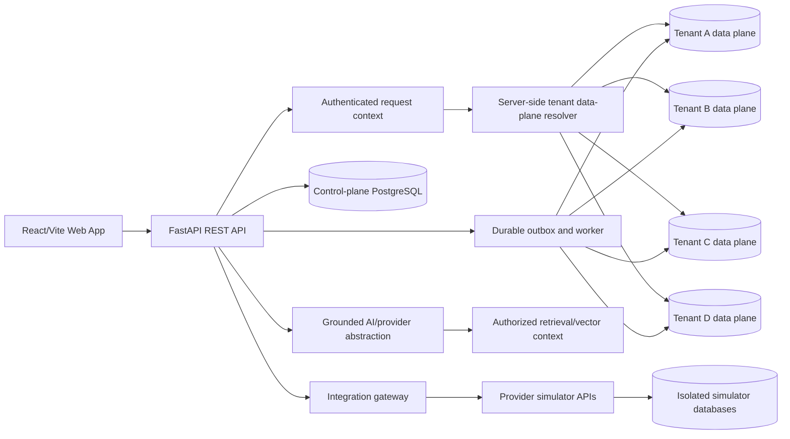

# System Architecture

The control plane must remain separate from customer business data. A global replacement of `get_db()` is unsafe because authentication, tenant administration, plans, mappings and audit control data belong in the control plane. Business services migrate to `get_data_plane_db` incrementally and must be validated route by route.

## Request path

1. Browser sends an authenticated request.
2. Request context derives user, role and tenant from the durable session.
3. Server authorization checks tenant membership, role, object/field/action policy and entitlement.
4. Control-plane routes use the control-plane session.
5. Business routes use the server-resolved customer data-plane session.
6. Mutations write audit/outbox records where required.
7. Background workers claim durable work and preserve tenant scope.
