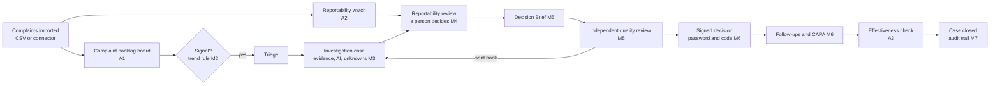
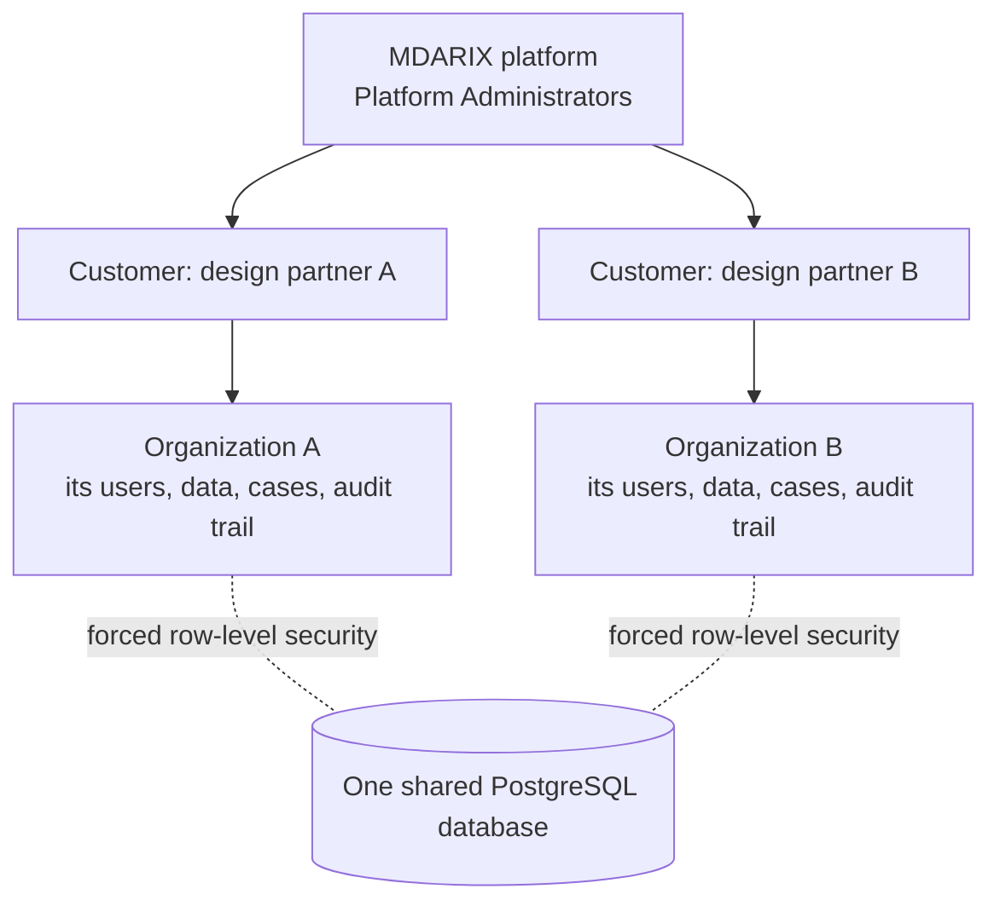
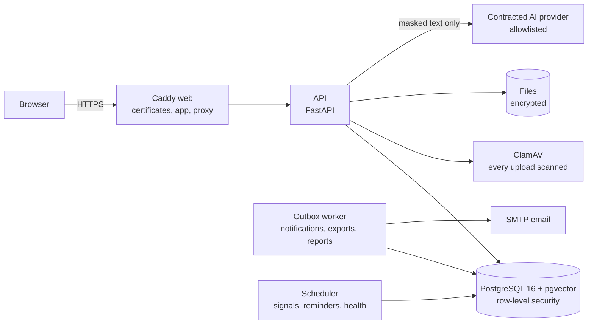

# MDARIX MVP 1.0: Updated Scope (Proposed)

Status: **PROPOSED, 2026-10-11.** Once approved, it replaces the scope in
[MVP_SCOPE_AND_DEMO_READINESS.md](MVP_SCOPE_AND_DEMO_READINESS.md) (frozen 2026-09-29 for the synthetic demo). This
document changes no code. It decides what MVP 1.0 shows, what is frozen until funding, and the three small additions
that make the MVP answer the most painful problem instead of a random feature.

## 1. The short answer

The reduced MVP proposed earlier showed the right **core**: the investigation itself, from signal to signed decision.
That is the most valuable part, but on its own it misses where regulators hurt companies most.

Recent FDA warning letters to device makers fail them on four things, in this order:
1. Complaints not recorded, or recorded as something else.
2. Complaints not investigated, or left in a backlog.
3. Reportable events reported late, or never.
4. Trends not escalated to corrective action (CAPA), and CAPAs not checked for effectiveness.

The earlier proposal covered the investigation and the trend detection. It **weakened** reporting: it folded the
regulatory review into an optional checklist, against the evidence. It also had **no** backlog view and **no**
effectiveness check.

This update corrects that. MVP 1.0 is one closed loop, **"no complaint left behind, no report late, no CAPA
unchecked"**, built mostly from what exists today, plus three small additions on data MDARIX already stores. Everything
else is frozen until funding.

## 2. The evidence: what regulators cite

We reviewed thirteen 2025-2026 FDA warning letters to small and mid-size device makers, chosen because they cite
complaint handling. Each letter can cite several failures, so the rows overlap.

| Failure cited | Letters | Examples |
|---|---|---|
| Complaint handling (QMSR, formerly 21 CFR 820.198) | 13 of 13 | All |
| Reporting: late or missing reports, or no reportability evaluation (21 CFR 803) | 10 of 13 | Beta Bionics, React Health (3B Medical), ZOLL, Envoy, Avertix, Leltek, DFI, Noah Medical, EpiCare, Robbins |
| CAPA: trends not escalated, CAPAs closed early or never checked | 10 of 13 | ZOLL, React Health, Leltek, Beta Bionics, Avertix, Envoy, Contec, Diowave, Noah Medical, EpiCare |
| Complaints not investigated, or a backlog | 6 of 13 | Beta Bionics (closed without investigation), EpiCare (every 2024 complaint still open), Envoy (open ~7 months), Robbins, React Health, Noah Medical |
| Complaints not recorded, or recorded as an inquiry or a repair | 5 of 13, plus ZOLL's coding | React Health, Leltek, Contec, DFI, Avertix. At ZOLL, coding hid 50 complaints the firm counted as 27. |

Across all device warning letters of Q1 2026 (17 letters), CAPA was cited in 9 and complaint files in 6 (Covington,
May 2026). Since 2 February 2026 the FDA's quality rule is the QMSR, aligned with ISO 13485. Customer-facing wording
should cite ISO 13485 §8.2.2 (complaint handling) and §8.5.2 (corrective action) rather than the old 820 sections.

## 3. MVP 1.0 scope

### 3.1 Kept: the core that exists today

| # | Capability | Pain it answers | Status |
|---|---|---|---|
| M1 | **Complaint intake**: CSV import, plus two connectors (one complaint system such as TrackWise or Veeva QMS, one ERP such as SAP for lots) | Complaints must be recorded completely | Implemented |
| M2 | **Signals**: complaints grouped by product, version and problem; a threshold raises a signal with a triage task | Trends not escalated | Implemented (`backend/app/signals`) |
| M3 | **Investigation case**: versioned scope, evidence, AI analysis with sources, competing explanations and unknowns, Ask MDARIX | Complaints not properly investigated | Implemented |
| M4 | **Reportability review**: a person records the assessment and its outcome. MDARIX never decides reportability. | Late or missing reports | Implemented (`backend/app/case_reviews`), extended by A2 |
| M5 | **Decision Brief** and independent quality review: nobody reviews their own brief | Weak, undocumented conclusions | Implemented |
| M6 | **Signed decision**: password and authenticator code; follow-ups, including opening a CAPA | Trends not escalated to CAPA | Implemented (`backend/app/decision_followups`) |
| M7 | **Audit trail**: tamper-evident hash chain, and a trust view per case | Proving what was done, by whom, when | Implemented |
| M8 | **Organizations (tenants) and administration**: see section 5 | Data separation per customer, trust | Implemented. Phase 5 support access is built but not yet committed. |
| M9 | **Case aging**: due dates, overdue and due-soon counts per case | Backlog of open investigations | Implemented (`backend/app/case_workflow`) |

### 3.2 Added: three small features on data MDARIX already stores

| # | Addition | Pain it answers | Why it is small |
|---|---|---|---|
| A1 | **Complaint backlog board**: open complaints by age that are not linked to any signal or case, measured against the organization's own target days | Complaints not investigated, backlogs | Complaints already have a status, dates and signal links; case aging (M9) already exists |
| A2 | **Reportability watch**: complaints marked serious injury, death or malfunction, with the days since awareness measured against **the reporting windows the organization configures from its own procedure**. A person still decides; the screen only shows the clock and who has not decided yet. | Late or missing reports, the most cited failure after complaint handling | Complaints already store awareness date, serious injury, death, malfunction and patient involvement |
| A3 | **CAPA effectiveness check**: a CAPA opened from a decision gets an effectiveness-check date, the scheduler reminds its owner, and the check is recorded and signed | CAPAs closed early or never checked | CAPA records already have a due date and an effectiveness-check date |

**A2 changes one stated principle.** Today `backend/app/case_reviews/service.py` says MDARIX "computes no reporting
deadline". A2 keeps "MDARIX never decides reportability". The windows would come from the organization's own
procedure, entered by its administrator, not from MDARIX. This needs your approval and, ideally, a regulatory
advisor's review of the wording.

### 3.3 Next, after the first pilot (not in MVP 1.0)

- **Misclassified-complaint screen**: AI reads service, repair and inquiry records and flags those that look like
  complaints, for a person to decide. It answers the "recorded as something else" failure (5 of 13 letters plus ZOLL)
  and would be the strongest differentiator. It goes after MVP 1.0 because it needs the partners' service data and
  careful validation. Show it on the roadmap slide.

### 3.4 Frozen until funding (the code stays; screens are hidden, no new work)

| Area | Why it waits |
|---|---|
| Cell architecture phases 6 to 12 (per-cell storage and keys, two-cell proof, integration in the cell, custom fields, per-cell AI policy, upgrades, cutover) | Pilots run on the shared database (decision of 2026-10-03). Phases 2 to 4 stay in the code, unused in MVP. |
| Dedicated customer databases (data planes) | Same |
| 11 of the 14 connectors | CSV import covers any other system during a pilot |
| Platform console beyond five areas (customers, users, AI settings, audit trail, system health) | Fewer screens to explain and support |
| Plans, subscriptions, renewals, reminders | Pilots are invoiced by hand |
| Regulatory submission drafting (eSTAR), counterfactual and scenario intelligence | Impressive, but not what buyers fail audits on. Show them on the roadmap slide. |
| Inbound evidence email, supplier requests | Not needed for the loop |
| Formal validation package (IQ/OQ/PQ), key-vault integration, penetration test | Funded work. Until then: "validation-ready design", and no compliance claims. |

## 4. The MVP 1.0 process

### 4.1 The loop

Case statuses are unchanged: Open, In progress, Brief in review, Ready for decision, Decided, Closed (also On hold
and Cancelled; nothing is deleted).

### 4.2 People: two role bundles plus the administrator

MVP 1.0 needs **no new roles**. A pilot team gets two bundles of the existing workflow roles (`backend/app/role_codes.py`):

| Person | Existing roles assigned | Does |
|---|---|---|
| **Investigator** | Triage Lead, Investigator | Watches the backlog and signals, opens cases, collects evidence, writes the Decision Brief |
| **Reviewer-Approver** | Regulatory Reviewer, Risk Reviewer, Reviewer, Approver | Records reportability, reviews the brief, signs the decision, signs the effectiveness check |
| **Customer Administrator** | Customer Admin | Users, roles, data connections. Never works on cases. |

The rule that nobody reviews or signs their own brief stays, so the smallest pilot team is **two people plus an
administrator**. Larger teams can still split the roles (and the Quality Manager can hold Leader). Nothing is removed.

## 5. Organizations (tenants): still holds, unchanged

The tenant model stays exactly as it is. It is part of the MVP's credibility, because each design partner is a
separate organization and must never see another's data.

- **Isolation:** one shared database, with row-level security forced on every organization-owned table. A test fails
  when a table lacks a policy (`tests/test_rls_coverage.py`).
- **Lifecycle:** Platform Administrators create customers and organizations; suspending a customer blocks its
  organizations.
- **Organization's own control:** its Customer Administrator manages people, roles, MFA, data connections and data
  exports. Each organization also has its own AI switch and AI budget.
- **Support access** (Phase 5): MDARIX staff see an organization's data only under a grant its own administrator
  approved, by area and for a limited time, and every use is in that organization's audit trail.
- **What waits:** a dedicated database or a separate "cell" per customer (section 3.4). It is designed and partly
  built (deployment roles, cell installer, platform link), and becomes the enterprise offer after funding.

## 6. Architecture for MVP 1.0 (current, deployment role `MULTI`)

| Part | MVP 1.0 |
|---|---|
| Application | One codebase in the `MULTI` role: API, outbox worker, scheduler, web (Caddy), ClamAV, in Docker Compose (`docker-compose.prod.yml`) |
| Database | PostgreSQL 16 with pgvector; forced row-level security; tamper-evident audit chain |
| Security | Passwords plus authenticator codes (required for administrators and signatures), rate limits, CSRF and origin checks, encrypted secrets, upload scanning |
| AI | Contracted providers only in staging and production; personal data masked before any request; per-organization switch and budget; AI advises, a person decides |
| Staging | Oracle Cloud Always Free ARM server, free (`docs/runbooks/STAGING_ORACLE.md`, ADR-017) |
| Pilots | Azure: managed PostgreSQL with point-in-time recovery, one VM, startup credits (ADR-017) |

## 7. The 15-minute demo, by pain

| Minute | Show | Pain answered |
|---|---|---|
| 0-2 | Import a month of complaints for an infusion pump | Complete intake |
| 2-4 | The backlog board: complaints older than the target, not linked to any signal or case | Backlog |
| 4-6 | A signal appears: false "blockage" alarms on version 2.1 | Trend escalation |
| 6-10 | The case: evidence, AI's competing explanations with sources, what is still unknown | Real investigation |
| 10-11 | The reportability watch: two serious-injury complaints, days left on the organization's own clock; the reviewer records the decision | Late reports |
| 11-13 | Brief, independent review, signature with an authenticator code, CAPA opened | Documented decision, CAPA |
| 13-15 | Effectiveness check scheduled; the audit trail shows every step and person | Effectiveness, audit readiness |

## 8. Before the first pilot with real data

- Lawyer-approved legal texts, or the private-staging decision (ADR-017).
- Phase 5 (customer-approved support access) committed and merged.
- For Azure: the key-vault connection and a decision on where uploaded files live (Azure Blob is not S3-compatible).
- An NDA and a data agreement per partner; anonymized exports first.

## 9. Decisions needed

1. Approve this scope (sections 3 and 4).
2. Approve A2's principle: the organization configures its reporting windows, MDARIX shows the clock, a person decides.
3. Choose the two MVP connectors: one complaint system, one ERP.
4. Approve the two role bundles as the default pilot setup.

After approval, an implementation plan for A1 to A3 and the screen-hiding follows, with estimates and tests,
in the same phase-by-phase form as the earlier plans.
