# B2 design spec: Cases, escalation to a Complaint, triage at two speeds, and Getting started Part 1

> **APPROVED by the owner on 7 Nov 2026** ("approve B2 spec with recommendations"):
> - OD-1 to OD-12 as recommended, with two notes:
>   - **OD-7:** the fast-track target stays **settable from 1 to 24 hours**, with a default of 4 clock hours.
>   - **OD-1:** the retention periods are to be **checked against the owner's SOP and privacy law** before go-live.
> - **Sequencing:** all of B2 (including the rename and Getting started Part 1) before the 4 Dec freeze; **B3 moves to just after the WHIF event.**
> - The build waits for the owner's green signal.


**Version 1, 7 Nov 2026. Status: APPROVED by the owner on 7 Nov 2026 (see "Approval record").** No code is changed by this document.
**Release:** 0.10.93 (backlog item B2, capability C1). Target 28 Nov 2026.
**Code read:** tag `v0.10.92` of `MDARIX-R1` (read only, with `git show`). Backend paths start at `backend/app/`; frontend paths at `frontend/src/features/workspace/`. Line numbers are at v0.10.92.

**Approved inputs this spec applies** (all in `MDARIX-planning/`):
- `development-cycle-1.md`: B2 row, the new terminology, step 2 items 2.1 to 2.17, Addendum A (C1) and Addendum B (the branching journey, the customer contact).
- `call-intake-deep-dive/gap-report.md`: D1 to D13, approved.
- `triage-deep-dive/gap-report.md`: T-D1 to T-D13, approved.
- `operating-modes.md`: M1 to M6, approved (MDARIX Connect and MDARIX Complete).
- `pms-coverage-map.md` §3: the 10 guardrails.
- `reviewer-feedback-log.md`: the one-record point from the external review of the service and complaint flow.
- `scenario-register.md`: IN-01 to IN-24, RG-06, RG-09. This spec adds CI-xx and TR-xx to it.

**Words used here.**
- **Case**: the record the service desk team creates when a call, e-mail or other contact comes in. In the code it is still `intake_events` (table names do not change; only the words on screen do).
- **Complaint**: a Case escalated, or a complaint imported from the customer's QMS.
- **Investigation**: what some screens call "Case" today. That word goes.
- **Owned here / owned elsewhere**: MDARIX Complete / MDARIX Connect, per domain.

---

## Contents
1. What changes for the user (one page)
2. The data model
3. States and transitions
4. Screens and exact labels
5. Clocks
6. Roles, permissions and segregation of duties
7. The audit trail and records
8. Scenario coverage
9. Migration of existing data
10. Build plan
11. Open decisions, with recommendations
12. What could not be verified

---

## 1. What changes for the user (one page)

### The idea in four lines
1. The service desk logs a **Case** for every contact. It is checked with the same ten questions as today.
2. A Case that alleges a deficiency **becomes the Complaint**. Same record, same reference, nothing typed again. Service work and complaint work sit on that one record.
3. **Every Complaint is triaged**: one click for a routine one, a short form on the fast track (4 hours) for anything with harm or a safety flag.
4. Getting started Part 1 follows one sample Case, **SAMPLE-CASE-11**, from the call to the submission, and shows where a service-only Case or a non-reportable complaint branches off.

### Before and after

| Area | Today (0.10.92) | After B2 (0.10.93) |
|---|---|---|
| Name of the record | "Call" or "first contact"; "Case" also means an investigation | **Case**. "Case" never means an investigation again: those spots say **Investigation**. |
| A Case signed "Complaint" | Gets a QMS task. No complaint exists in MDARIX until a QMS export is imported. Reportability, reports and closure cannot start. | **Becomes the Complaint at once**, in the same signature. Triage, the reportability tree and the report start the same day. The QMS ID is filled in later by import (Connect), or never needed (Complete). |
| A service call that alleges a fault | Classified "Both". The complaint still waits for the QMS. | Classified **"Complaint and service"**: one record with a Service section and a Complaint section. |
| Traditional companies | — | Optional per organisation: **service ticket first, then escalate**. The Complaint is a copy with a link; nothing is typed twice. The classification rule does not change. |
| Outcomes | Complaint · Both · Service only · Pending · Pending: confirm no deficiency | **Complaint · Complaint and service · Service only · Inquiry · Pending · Not a complaint (no deficiency confirmed)** |
| Awareness on a logged Case | Forced to the time of the call | **The earliest time anyone acting for you knew**, with who knew first |
| The reporting clock | Visible only while triage is open; gone after triage (C2) | **Visible on the Case, and carried to the Complaint** without a gap |
| Pending | Can sit with nothing due after its follow-up closes | **Always an owner, a due date and an alert** |
| "No QMS complaint needed" | Any writer, a 10-character reason, no signature | Gone. In Connect: **"QMS complaint not expected"**, signed, with a named reason, by someone other than the Case's signer. |
| QA reviewer = signer | Allowed everywhere | **Refused outside the trial** |
| Unknown lot | Refused | **Kept as typed**, flagged "not in your master data" |
| Wrong fact | Cannot be corrected | **Correct a fact** with a reason; history kept |
| Names or phone numbers in the words | Stored | **Masked** when the Case is saved |
| Country | Free text ("Germany" ≠ "DE") | **ISO country code** from a picker |
| Many Cases | One by one | **Bulk assign and bulk follow-up**. Never a bulk signature. |
| Triage | Flagged records only; a death after triage reopens nothing | **Every Complaint**, fast or routine. Reopens itself on new harm, with an alert. |
| Getting started step 1 | Opens the RV-11 complaint page; ticks on the visit | Opens **SAMPLE-CASE-11's Case check**; the story branches |

### Click counts (smallest path, desktop, sample data; counted from the design, not timed)

| Task | Today | After B2 |
|---|---|---|
| Log a Case and sign it (questions answered while logging) | 14 clicks + password and code | 14 clicks + password and code (escalation is inside the signature: **0 extra**) |
| Get from a signed complaint Case to a record that can be assessed | 2 clicks (type the QMS ID) + wait for an import, often days | **0 clicks, 0 wait** |
| Routine triage of a complaint | none happens (no owner, no first look) | **1 click** ("Confirm triage") |
| Fast-track triage, all facts known | 3 clicks + typing | 4 clicks + typing (adds the potential harm) |
| Clear a public health threat | impossible | 2 clicks + reason + password and code |
| Getting started steps 1 and 2 (sample) | 1 click, nothing reviewed | 3 clicks + password and code: open the Case, answer the one open question, sign and escalate |
| Assign 30 Cases to a colleague | 30 × (open, choose, save) | 3 clicks (tick all, Assign to, the person) |

---

## 2. The data model

### 2.1 Case, event and Complaint: the shape

```
                 one EVENT (what happened once, in the field)
 ┌────────────────────────────────────────────────────────────────────────────┐
 │  CASE  (intake_events)                    COMPLAINT  (complaints)            │
 │  how it came in: channel, words,   ──►    the complaint work: triage,        │
 │  times, parties, the signed Case          markets, reports, investigation,   │
 │  check history, service request           service work, closure             │
 │                                                                              │
 │  linked by intake_events.complaint_id  +  a LINKED record_link (as today)    │
 │  other records of the same event join through record_links (duplicates,     │
 │  a second caller, a QMS record) and share the earliest awareness             │
 └────────────────────────────────────────────────────────────────────────────┘
```

**Decision taken in this spec (guardrails 1 and 9):** the Case row **is** the event's entry record. It has a fixed `kind` (how MDARIX received it: logged contact, urgent, imported service record) and an **open `channel`** (phone, e-mail, web form, distributor, returned goods, literature, social media, regulator notice, and values added later without a migration). A later literature finding, registry signal or e-mail draft is another Case with another channel. No separate events table is added in B2 (see OD-9).

**One record for the user, two rows in the database.**
- The Case row keeps what came in, verbatim, and the signed Case check history. It is never rewritten.
- At escalation the system copies each fact once into the Complaint row. Nobody types it again.
- From then on, **the Complaint row is the only place a shared fact is corrected**. The Case's copy reads "as received".
- In the default **one-record mode** the Complaint takes the Case's reference (`complaint_identifier` = `CASE-…`). The user sees one ID from the call to closure.
- In the **traditional mode** (service first) the Complaint gets its own reference and both records link to each other.

### 2.2 One record vs the traditional mode

| | One record (default) | Service first, then escalate (optional per organisation) |
|---|---|---|
| Setting | Settings › Complaints › "How cases become complaints": **"One record: the case becomes the complaint"** | **"Service ticket first, then escalate"** |
| Classification rule | Any alleged deficiency is a complaint (Q1–Q3 Yes) | **The same.** The traditional mode changes the records, never the rule. |
| What escalation makes | The Complaint, same reference as the Case | A new Complaint with its own reference, every fact copied, both linked |
| Service work | On the Complaint's Service section | Stays on the Case (the service record); the Complaint shows it as linked |
| Pages | One page: the Case section, the Service section and the Complaint sections | Two pages, each with "Linked: CASE-… / CASE-…'s complaint" |
| Clock | From the Case's awareness | The same: the Complaint never counts from its own creation |

### 2.3 Fields, grouped (✚ = new column)

Mandatory rules are in 2.4. "Both" = on the Case and carried to the Complaint at escalation.

**Customer**

| Field (screen label) | Case column | Complaint column | Notes |
|---|---|---|---|
| Reporter type | `reporter_type` | `reporter_type` | Hospital · Clinic · Care home · Patient or lay user · Distributor · Service agent · Other |
| Site or organisation | `reporter_site` | via the party (below) | Masked check runs on it (no person's name) |
| Reporter's country | ✚ `reporter_country` (ISO alpha-2) | — | Separate from the incident country (CI-05) |
| Contact | ✚ party row (see 2.6), per OD-1 | same party row | Rules in OD-1 |
| Channel | ✚ `channel` (open text, code list in code) | — | Backfilled: CONTACT → `PHONE`, URGENT → `PHONE`, SERVICE_RECORD → `SERVICE_RECORD_IMPORT` |
| Reference in that channel | ✚ `channel_ref` (message ID, ticket, web-form number) | — | |
| Anonymous or no contact | ✚ `no_contact_reason` | — | "Follow-up impossible": Pending never waits for ever (CI-04) |

**Product**

| Field | Case column | Complaint column | Notes |
|---|---|---|---|
| Product | `product_id` | `product_id` | Obsolete products stay selectable, marked "Obsolete" (IN-24) |
| Product as typed | ✚ `product_text` | ✚ `product_text` | When the product is not in master data (D9) |
| Version | `product_version_id` | `product_version_id` | |
| Lot | `lot_batch_id` | `lot_batch_id` | |
| Lot as typed | ✚ `lot_text` | ✚ `lot_text` | An unknown lot is kept and flagged, never refused (D9) |
| Serial number | `serial_number` | `serial_number` | |
| UDI | ✚ `udi` | `udi` (exists) | |
| Software version | ✚ `software_version` | ✚ `software_version` | |

**Event**

| Field | Case column | Complaint column | Notes |
|---|---|---|---|
| When it happened | `event_at` + `event_zone` | `event_timestamp` | Empty = "Not known" (IN-07), never invented |
| Country where it happened | `country` (now an **ISO code**) | `country` (ISO code when MDARIX writes it) | Legacy free text moves to ✚ `country_text` |
| First known by (party, time, basis) | `first_knowledge_party`, `first_knowledge_at`, `first_knowledge_basis` (exist) | — | Now asked on every Case, not only urgent (H1) |
| Received | `received_at` + zone | `complaint_timestamp` | |
| Awareness | `awareness_at` + zone | `awareness_timestamp` | Computed: the earliest qualifying time (5.1) |
| Why entered late | ✚ `late_entry_reason` | — | Needed when entry is more than 1 working day after receipt |
| Use environment, user type | exist | — | |

**Patient and harm** (minimised; age band and sex are asked at the report in B3, where a form needs them)

| Field | Case column | Complaint column | Notes |
|---|---|---|---|
| Harm alleged (Q4), death or serious injury (Q5), could cause serious harm again (Q6) | `first_contact_checks.answers` | `patient_involved`, `serious_injury`, `death`, `malfunction` (set from the answers at escalation: Yes → true, No → false, Unknown/Not stated → null) | Unknown stays null, never false |
| Patients involved | ✚ `patients` (`NONE`, `ONE`, `SEVERAL`, `NOT_KNOWN`) | — | Several patients: "Split into one case per patient" (2.5) |
| What happened to the patient | ✚ `harm_text` (masked) | carried into the description addendum | |

**Service**

| Field | Case column | Complaint column | Notes |
|---|---|---|---|
| What they asked for | `requested` (+ value `PARTS`) | — | Repair · Maintenance · Installation · Calibration · Training · Parts · Information · Nothing asked for |
| What was tried on the call | ✚ `troubleshooting` | shown on the Service section | The external review's step 2 ("troubleshooting") |
| Service ticket | `service_ticket` | `service_reference` (exists, tr12) | |
| Service status | ✚ `service_status`, `service_status_at` | `service_status`, `service_status_at` (exist) | OPEN · IN_PROGRESS · COMPLETE. Service complete never closes a complaint (exists). |
| Service owner | ✚ `owner_id` doubles as it before escalation | `service_owner` (exists) | |

**Classification** (`first_contact_checks`, versioned as today)

| Field | Column | Notes |
|---|---|---|
| The ten answers, unknowns | `answers`, `unknowns` | Unchanged |
| Guide version | `guide_version` | New starter text `case-check-starter-2` for new versions; signed versions keep theirs |
| Suggestion, classification | `suggestion`, `classification` | Check constraint widened: + `INQUIRY`, `NOT_A_COMPLAINT` |
| Override reason, reason | exist | |
| QA review | `review_outcome`, `reviewed_by/at`, `review_note` | Now for Service only, Inquiry and Not a complaint |
| Case status, owner | ✚ `intake_events.status`, `owner_id` | Section 3 |

**Origin** (every record; operating-modes rule 2)

| Field | Case | Complaint | Triage record |
|---|---|---|---|
| Source system | `source_system` (exists) | `source_system` (exists) | `source_system` (exists) |
| External ID | ✚ `source_identifier` | `source_identifier` (exists) | ✚ `source_identifier` |
| Last sync | ✚ `last_synced_at` | ✚ `last_synced_at` | — |
| Who owns it | ✚ `record_owner` (`MDARIX` / `EXTERNAL`) | ✚ `record_owner` | follows its subject |
| QMS complaint ID | `qms_ref` (exists) | ✚ `qms_ref` (unique per organisation when set) | — |

`record_owner` is set at creation from the organisation's setting, so changing the setting later never flips existing records silently. A Connect complaint created by escalation is `MDARIX` until the import fills its QMS ID; then it passes to `EXTERNAL` automatically, audited (the QMS becomes master of the master fields; MDARIX stays master of its own decisions).

### 2.4 Conditional mandatory rules

**Always, on every Case:** the reporter's words (10 characters or more), the received time and its zone, the channel, and a product, a product as typed, or "Not named" with a reason.

**By stage**

| Stage | Mandatory | Never mandatory (asked later, never blocks) |
|---|---|---|
| Log a case | words, received + zone, channel, product (or typed, or "Not named" + reason) | the ten answers, the country, the lot, the event date |
| Log, first knowledge earlier than receipt | who knew first, their basis (acts for us / our procedure counts them / not acting for us), the time + zone | — |
| Log, entered more than 1 working day after receipt | `late_entry_reason` | — |
| Sign the Case check | all nine answers (Q10 is free text); any Not applicable on Q1–Q6 needs its note | the incident country |
| Sign: Complaint | — | — |
| Sign: Complaint and service | service ticket, or "Service logged in MDARIX" (Complete) | — |
| Sign: Service only | a reason (10+); what they asked for ≠ Information or Nothing | — |
| Sign: Inquiry | a reason (10+); what they asked for = Information or Nothing | — |
| Sign: Not a complaint | a follow-up closed "Answered" whose note records "no deficiency"; a reason (10+) | — |
| Sign: Pending | — (the owner and due date are set by the system) | — |
| Sign: overriding the suggestion | override reason (10+); Service only, Inquiry and Not a complaint are never reachable by override | — |
| Escalation | the duplicate choice when a likely match exists ("attach" or "create new") | the QMS ID (Connect fills it by import), the incident country (escalation never waits) |
| Routine triage | owner, severity, immediate action or why none, product (or "Not known yet" + follow-up) | — |
| Fast-track triage | as routine + potential harm (when a malfunction is alleged), the threat question (when a death is recorded), structured containment, a backup when 2+ people are active, awareness confirmed when unresolved or in conflict | the product (may be "Not known yet" with a follow-up) |
| The reportability tree (gate set by B2) | the incident country (RG-06), the awareness date | — |
| QMS complaint not expected (Connect) | a named reason + its detail, password and code, a person other than the Case's signer outside the trial | — |

**By market.** B2 adds no market-specific field. The market decides only which provisional clock shows (5.2). Every report-form field per market is B3, B8 and B9.

**By outcome** (what each signed outcome starts)

| Outcome | Starts | Triage? |
|---|---|---|
| Complaint | the Complaint (or attach); routine or fast triage | Yes |
| Complaint and service | as Complaint, plus the Service section with the ticket | Yes |
| Service only | QA review (5 working days; 1 working day, never over 24 h, with a fault or harm word) | Only if flagged |
| Inquiry | QA review, as Service only | Only if flagged |
| Not a complaint | QA review, as Service only | Only if flagged |
| Pending | follow-up with the reporter, due end of the next working day; owner = the Case owner | Only if flagged |

### 2.5 New actions on a Case (data behind them)

| Action | What it writes |
|---|---|
| Correct or add a fact | the field's new value; a `record_field_changes` row (source `CORRECTION`, the reason); the reporter's words are never edited |
| Add an addendum | a new row in ✚ `case_addenda`: text (masked), who said it (reporter · technician · distributor · our staff), when, kind (`STATEMENT`, `WITHDRAWAL`, `TECHNICIAN_FINDING`, `CORRECTION_BY_REPORTER`) |
| Split into one case per device or patient | sibling Cases, the same words and awareness, linked as one event (`record_links`, reason "split from CASE-…") |
| Mask personal data | the words, site, notes and addenda masked on save, with the import's own masking (`trial/imports.py` `_personal_match`, `_masked_words`, moved to a shared module); ✚ `masked` JSON on the Case lists what kind was masked and how many, never the value |
| Withdraw: entered in error | ✚ `voided_at`, `voided_by`, `void_reason`, `void_signed_record_id`; only before escalation |

### 2.6 Party roles (guardrail 8)

The existing `external_parties` table (tr06, used by the communications log) holds the parties. B2 links it to Cases and opens its roles.

| Change | Why |
|---|---|
| ✚ `external_parties.intake_event_id` | A party belongs to a Case before there is a Complaint; `complaint_id` is set at escalation |
| Drop the `party_type_known` check; validate in code against a list | Roles stay open: `REPORTER`, `CUSTOMER`, `DISTRIBUTOR`, `IMPORTER`, `AUTHORISED_REPRESENTATIVE`, `USER_FACILITY`, `SERVICE_PARTNER`, `HOSPITAL`, and later ones without a migration |
| ✚ `acts_for_manufacturer` (bool), ✚ `country` (ISO) | Awareness (who knew first) and EU/US party rules |
| Contact columns (per OD-1) ✚ `contact_role`, `contact_email`, `contact_phone`, `preferred_channel`; the existing `primary_name` holds the name | The customer contact decision |

No party signs in yet. The "Look ahead" previews stay previews.

### 2.7 Every table and column change, and the migration

**One migration: `tr19_trial_cases_escalation.py`, revision `tr19casesescalation`, down_revision `tr18changereason`.**
- tr18's docstring says `tr17` and `tr19` were reserved for builds that needed none, so `tr19` is free. The chain on `release/0.10` at v0.10.92 ends at `tr18changereason` (0.10.92 added no migration).
- **Expand-only**: new nullable columns, new tables, widened check constraints. No column is dropped or renamed. Every new tenant table gets FORCE row-level security like tr04.
- Legacy dedicated organisation databases get the same through `scripts/add_workflow_tables_to_legacy_planes.py` (a function per change, as tr18 did with `add_change_reason`).

| Table | Change |
|---|---|
| `intake_events` | ✚ `channel` varchar(40), `channel_ref` varchar(200), `status` varchar(20) NOT NULL default `OPEN` (check: OPEN, PENDING, IN_REVIEW, CLOSED, ESCALATED, VOIDED), `owner_id` varchar(255), `product_text` varchar(200), `lot_text` varchar(120), `udi` varchar(120), `software_version` varchar(60), `reporter_country` varchar(2), `country_text` varchar(80), `late_entry_reason` text, `no_contact_reason` text, `patients` varchar(12), `harm_text` text, `troubleshooting` text, `service_status` varchar(20), `service_status_at` tz, `masked` jsonb, `complaint_id` uuid, `escalation` varchar(10) (`CREATED`, `ATTACHED`), `escalated_at` tz, `escalated_by` varchar(255), `voided_at` tz, `voided_by` varchar(255), `void_reason` text, `void_signed_record_id` uuid, `source_identifier` varchar(255), `last_synced_at` tz, `record_owner` varchar(10). Composite FK (`tenant_id`, `complaint_id`) → complaints. Indexes: (tenant, status), (tenant, owner_id), (tenant, complaint_id). |
| `first_contact_checks` | Widen `suggestion` and `classification` checks: + `INQUIRY`, `NOT_A_COMPLAINT`. |
| `complaints` | ✚ `qms_ref` varchar(120) with a partial unique index (tenant_id, qms_ref) WHERE qms_ref IS NOT NULL; ✚ `product_text`, `lot_text`, `software_version`, `last_synced_at`, `record_owner`. |
| `triage_records` | ✚ `version` int NOT NULL default 1, `speed` varchar(10) (`FAST`, `ROUTINE`), `due_at` tz, `potential_severity` varchar(20), `severity_floor` varchar(20), `floor_reasons` jsonb, `flags_at_completion` jsonb, `containment` jsonb, `change_reason` text, `reopened_at` tz, `reopen_trigger` varchar(30), `threat_excluded_at` tz, `threat_excluded_by` varchar(255), `threat_exclusion_reason` text, `threat_signed_record_id` uuid, `awareness_signed_record_id` uuid, `inherited_from` uuid, `qms_triaged_at` tz, `qms_owner_text` varchar(255), `confirmed_by` varchar(255), `confirmed_at` tz, `source_identifier` varchar(255). `severity` accepts `NOT_KNOWN` (code-checked, no DB enum today). Index (tenant, speed, completed_at). |
| ✚ `triage_record_versions` | id, tenant_id, triage_record_id (FK, cascade), version, snapshot jsonb (every field), changed_fields jsonb (old → new), change_reason, changed_by, changed_at, signed_record_id. Unique (triage_record_id, version). |
| ✚ `case_addenda` | id, tenant_id, intake_event_id (FK, cascade), kind, said_by_role, said_at + zone, text, masked jsonb, created_by, created_at, source_system. |
| `external_parties` | ✚ `intake_event_id` uuid (FK → intake_events, SET NULL), `acts_for_manufacturer` bool, `country` varchar(2), and the OD-1 contact columns; drop check `party_type_known`. |
| `oversight_settings` | ✚ `triage_fast_hours` int NOT NULL default 4 (check 1–24), `case_flow` varchar(20) NOT NULL default `ONE_RECORD` (check `ONE_RECORD`, `SERVICE_FIRST`), `backlog_days` int NOT NULL default 30, `backlog_target_days` int NOT NULL default 10. |
| ✚ `record_ownership` | id, tenant_id, domain varchar(40) (open: `COMPLAINTS` in B2; `SERVICE`, `CAPA`, `PRODUCTS` later), owner (`MDARIX`, `EXTERNAL`), system_name varchar(120), set_by, set_at. Unique (tenant, domain). No row: a trial reads `MDARIX` (M3); a pilot reads `EXTERNAL` (today's behaviour). |

**Code-only changes, no schema:** new permissions and the Service Desk role (section 6); `rules.OUTCOMES`; the import's matching by `qms_ref`; the `make_reference` prefix `CASE` (see OD-8).

**mvp-1.0 impact.**
- mvp-1.0 has `md64mergetrialtr18`. When main (with 0.10.93) is merged into mvp-1.0, add **`md65_merge_trial_tr19.py`** (revision `md65mergetrialtr19`, down_revision (`md64mergetrialtr18`, `tr19casesescalation`)), no schema change, the same pattern as md53–md64. 0.10.92 itself added no migration, so its merge needs none.
- `git diff v0.10.92 mvp-1.0` shows no change in the files B2 touches (intake, complaints model, permissions, personas, one_story, imports, oversight models), so no code conflict is expected there.
- mvp-1.0's signing grants (md49: a second administrator confirms a signing role) must cover the new signatures (threat exclusion, later awareness, QMS not expected, void). The forward merge must add these meanings to the grant check. Noted as a risk (10.3).

---

## 3. States and transitions

### 3.1 Case states (stored in `intake_events.status`; one function sets it)

| State | Screen label | Means |
|---|---|---|
| `OPEN` | To check | Logged; Case check not signed (or reopened) |
| `PENDING` | Waiting for the reporter | Signed Pending or "Pending: confirm no deficiency"; a follow-up or a re-sign is due |
| `IN_REVIEW` | QA review | Signed Service only, Inquiry or Not a complaint; QA review open |
| `CLOSED` | Closed: service only · Closed: inquiry · Closed: not a complaint | QA review agreed |
| `ESCALATED` | Complaint | Became (or was attached to) a Complaint. Its life continues on the Complaint. |
| `VOIDED` | Withdrawn: entered in error | Only before escalation |

"Pending: confirm no deficiency" stays as the suggestion's own wording inside Pending, so existing signed versions keep their meaning.

### 3.2 Case state diagram

```mermaid
stateDiagram-v2
    [*] --> OPEN: Log a case (log)
    [*] --> ESCALATED: Urgent case (anyone with a workspace role) creates the Complaint at once
    OPEN --> ESCALATED: Sign "Complaint" / "Complaint and service" [SIGN] (classify)
    OPEN --> PENDING: Sign "Pending" [SIGN] (classify)
    OPEN --> IN_REVIEW: Sign "Service only" / "Inquiry" / "Not a complaint" [SIGN] (classify)
    OPEN --> VOIDED: Withdraw: entered in error [SIGN] (review; not the logger outside the trial)
    PENDING --> OPEN: Follow-up closed -> re-sign task (system)
    PENDING --> ESCALATED: Re-sign as Complaint, or follow-up unresolved after the set attempts [SIGN] (classify)
    PENDING --> VOIDED: Withdraw: entered in error [SIGN] (review)
    IN_REVIEW --> CLOSED: QA review "Agree" [SIGN] (review; never the signer outside the trial)
    IN_REVIEW --> ESCALATED: QA review "Reclassify as a complaint" [SIGN] (review)
    CLOSED --> OPEN: New information (addendum or corrected fact with a harm or fault word) -> reopened (system or classify)
    CLOSED --> IN_REVIEW: 30-day rescan finds a harm or fault word (system)
    ESCALATED --> ESCALATED: Reporter withdraws (addendum only: the complaint stands)
```



**Rules on the diagram**
- **Escalation is upward and needs no second person.** Anyone who may classify may escalate. Under-classification is the regulatory risk, so the way up is open.
- **Every way down is reviewed by a second person outside the trial:** Service only, Inquiry, Not a complaint, Withdraw, QMS complaint not expected.
- **A Complaint is never down-graded and never withdrawn by the caller.** A withdrawal is an addendum. The Complaint then asks "Is an investigation still needed?" (IN-18); that answer is part of the disposition (B7's routine path).
- **Reclassification** always makes a new signed version of the Case check (as today); awareness never moves.
- **Reopen** of a CLOSED Case makes a new unsigned version, prefilled with the last answers; it is "To check" again with a "Reopened: <why>" line.

### 3.3 Escalation, step by step (one-record mode)

| # | What happens | Who / system |
|---|---|---|
| 1 | The signer picks Complaint or Complaint and service. The sign panel shows "This case becomes a complaint". | Classifier |
| 2 | Likely duplicates are listed (same product and lot or serial, same market, event within 2 days; or same serial at any date; or same QMS ID). One strong match is pre-selected "Attach to …". | System |
| 3 | Password and authenticator code. One signed record: the classification **and** the escalation. Meaning: "I have checked case CASE-… with guide case-check-starter-2 and classify it: complaint. It becomes a complaint in MDARIX now." | Classifier |
| 4 | "Create": a Complaint row (`complaint_identifier` = the Case reference, `source_system` = `MDARIX_CASE`, `source_identifier` = the Case reference, `record_owner` from the setting, `status` = `open`), facts copied, a LINKED `record_link`, `intake_events.complaint_id` set. "Attach": only the link and `complaint_id`. | System |
| 5 | The Case's flagged triage (if any) is inherited by the Complaint (T-D8). Otherwise routine or fast triage starts (4.6). | System |
| 6 | Connect: a task "Enter the QMS complaint ID (optional: your import fills it)", due in 5 working days; at 10 working days it asks "link by hand, or sign QMS complaint not expected". Complete: no task. | System |
| 7 | The page opens on the Complaint; the main button is "Next: Triage". | Screen |

**Traditional mode** differs only at step 4: a new reference (`CMP…` business ID shown), the Case stays a service record with its own page, and both pages show the link.

**QMS import merge (Connect).** When a complaints file arrives:
1. A row whose `complaint_id` equals an MDARIX complaint's `qms_ref`, or a Case's typed `qms_ref` whose Complaint exists, **updates that Complaint**: no second complaint. Its QMS ID is recorded, `record_owner` passes to `EXTERNAL`, `last_synced_at` is set, and each changed field goes to `record_field_changes` (source `IMPORT`).
2. A row whose ID two records claim is **set aside** with "Two complaints claim QMS ID X: reconcile them" (IN-14). The partial unique index makes this impossible to store twice.
3. A row that matches nothing creates a complaint, as today. The duplicate check then proposes a link to the MDARIX complaint; a person decides.
4. Field ownership: on an `EXTERNAL` record the file wins on master fields; on an `MDARIX` record a different value is listed as a conflict and is never written silently (operating modes §2).

### 3.4 Triage states and the two speeds

| State | Label | Means |
|---|---|---|
| `QUEUED` | To triage | No record yet, or reopened |
| `QMS_TO_CONFIRM` | From your QMS: confirm | Imported triage with a death or a threat: a person confirms |
| `DONE` | Triaged | A complete version exists |
| `INHERITED` | Triaged (from the event) | Copied from the event's triage when this record joined it |

| Speed | When | Target | The record |
|---|---|---|---|
| **Fast track** | urgent case, death, serious injury, harm "not known", potential harm Serious or above, public health threat ticked, any manual escalation, any automatic reopening | **4 clock hours** from reaching triage (setting 1–24) | The full form |
| **Routine** | every other Complaint | **End of the next working day** on the organisation's calendar | Three facts pre-filled; **one click** "Confirm triage"; any change opens the full form |
| — | Pending, Service only, Inquiry, Not a complaint, unless flagged | — | No triage. A flagged Case is triaged fast, before signing (safety never waits). |
| Imported backlog | imported complaints whose awareness is older than `backlog_days` (30) at import | `backlog_target_days` (10 working days) | Routine, in its own "Imported backlog" view |

```mermaid
stateDiagram-v2
    [*] --> QUEUED: Complaint created or imported (routine or fast by the flags)
    [*] --> QMS_TO_CONFIRM: Imported with QMS triage and a death or threat
    [*] --> DONE: Imported with QMS triage, no death or threat (accepted, source QMS)
    [*] --> INHERITED: Joins an event already triaged
    QUEUED --> DONE: Confirm triage (routine, 1 click) or Save the triage (fast) (triage)
    QMS_TO_CONFIRM --> DONE: Confirm the QMS triage (triage)
    DONE --> DONE: Update triage, new version + reason (triage); Exclude the threat [SIGN]; later awareness [SIGN]
    DONE --> QUEUED: Automatic reopening, fast track + alert (system); Escalate to triage + reason (anyone)
    INHERITED --> QUEUED: New harm or an earlier awareness on this record (system)
```



**Signatures in triage (T-D6): only two.**
- **Exclude the threat**: a reason, password and code; outside the trial, a person other than the one who ticked it.
- **A confirmed awareness later than the earliest known**: a reason, password and code; outside the trial, a second person.
- Everything else is saved, versioned and audited without a signature. An earlier awareness never needs one (the safe side).

**Severity rules**
- Choices: **Not known yet** · Negligible · Minor · Serious · Critical · Catastrophic.
- **Floor** from the facts: death = Catastrophic; serious injury = Serious; a QMS severity mapped by the scale = that level. Below the floor is refused. Below a mapped QMS level needs a reason.
- **Potential harm** ("worst credible harm if it happened again"): asked whenever a malfunction is alleged. Serious or above sends a routine item to the fast track.
- "Not known yet" keeps the fast track and creates a follow-up due in 1 working day. The tree then treats harm as unknown (the shorter clock).

**Automatic reopening (T-D7).** At completion the record stores its flags and floor. When any of these later raises the floor, or adds a death, a serious injury or a threat flag, triage reopens on the fast track, the target counts from the change, and the owners and the escalation role get an alert:
- a re-answered Case check; a corrected fact; an addendum with a harm word;
- an import that changes the harm fields;
- a link that brings an earlier awareness (as today) or more harm.

**Owners (T-D12).** Never guessed:
- re-triage starts from the recorded owners;
- routine starts with the Case's signer (a fact);
- fast track starts empty;
- a backup is required when two or more people are active (the one-person trial is allowed and says "one person").

**Containment (T-D11).** Choices plus text:
- None needed · User told how to stay safe · Device taken out of use · Hold the lot · Consider a field action · Other.
- **Hold the lot** opens a Lot impact task on the lot (tr08 exists).
- **Consider a field action** opens a "Field action decision" task (yes or no, with a reason). The full field-action module is later (FSCA).

**Triage belongs to the event (T-D8).** A record linked later gets an `INHERITED` copy (version 1, `inherited_from` set) and appears triaged. The hand-offs (closure, the tree's starting harm level, the report worksheet) read the event's record, whatever the subject kind.

**QMS triage (T-D9).** The complaints template gets optional columns `triage_date`, `triage_severity`, `triage_owner`, `immediate_action`. A row with them gets a record with source `QMS`, `DONE`, unless it holds a death or a threat: then `QMS_TO_CONFIRM` on the fast track. Bulk *assignment* of these is allowed; a bulk confirmation is not.

**Closed QMS complaints with harm (T-D13).** No triage. A closed death or serious injury with no signed market conclusion goes to the second look as "Closed without a reportability decision?".

**Two people at once.** `seen_version` on every triage write; the second save gets "A colleague changed this triage a moment ago; reload to see it" (as on the Case check).

---

## 4. Screens and exact labels

All screens keep the approved hero design: the list view picker, the filled primary button, the drawer beside the list, the stage line, cards on a phone. Nothing new is added to the navigation rail.

### 4.1 Complaints › list header
- Primary button: **"Log a case"** (was "Log a call"). It opens the **Cases** view with the drawer open.
- The persona's views change name: **"Cases"** replaces "Calls to check".

| Persona | Its views on Complaints |
|---|---|
| Admin | All open complaints · Due this week · **Cases** · Second look · Reporting · Waiting for the reporter |
| Quality Leader | All open complaints · Due this week · Past target · **QA review** · Second look |
| Regulatory Leader | Reportability: decision needed · Authority reports · Legal clocks this week |
| Complaint Handler | To triage · **Cases** · Second look · Waiting for the reporter |
| **Service Desk** (new) | **Cases** · Waiting for the reporter |
| Decision Maker | Waiting for my approval · Signed this month |

New list view: **"Imported backlog"** (under More views) for T-H8.

### 4.2 Log a case (drawer)
Title **"Log a case"**. Switch: **"Case"** · **"Urgent: death or serious injury"** (was "Urgent intake"; see OD-11). The groups fold; only the first two are open.

| Group | Fields (exact labels) |
|---|---|
| **What was said** | "The reporter's words, as they said them" (required). Hint: "Names, phone numbers and e-mail addresses are masked when you save." |
| **How it came in** | "Channel": Phone · E-mail · Web form · Field service visit · Distributor or agent · Returned product · Literature · Social media · Regulator notice · Other. "Reference in that channel (optional)". "Received" (date, time, zone; now by default). Link "Someone acting for you knew earlier" opens: "Who knew first": Our own staff · A distributor · An importer · An authorised representative · A service agent; "Acting for you?": Yes, they act for us · Our procedure counts them · No; "When they knew". |
| **Customer** | "Reporter type". "Site or organisation (no person's name)". "Reporter's country". "Contact" (per OD-1). Tick "No contact: anonymous or refused" with "Why". |
| **Product** | "Product" (picker; "Not in your products: type it"). "Version". "Lot" ("Not in your lots: kept as typed and flagged"). "Serial number". "UDI". "Software version". |
| **Event** | "When it happened" or tick "Not known". "Country where it happened" or "Not known yet". "Where it was used". "Who used it". |
| **Patient and harm** | "Patients involved": None · One · Several · Not known. "What happened to the patient (optional)". |
| **Service** | "What they asked for". "What was tried on the call". "Service ticket (optional)". |
| **The ten questions** | "Answer now, or at the Case check". As today. |

Buttons: **"Save the case"** (primary). Urgent: **"Send to triage now"**. After saving, a late entry asks inline: **"Logged more than a working day after it was received: say why"**.

### 4.3 The Cases view (list)
- Filter **"Which cases"**: To check · Waiting for the reporter · QA review · Became complaints (30 days) · Closed · Withdrawn · All.
- Columns: **Case** (reference, SAMPLE chip) · **Received** · **What was said** · **Product · lot** (a "not in master data" flag) · **State** · **Owner** · **Clock** (the shortest provisional clock of the Case's market, or "Complaint: see its page") · **Due** (the Case's next task).
- Row action: **"Open the case check"** (unsigned) or **"Open"**.
- Tiles above the list (as today): "To sign" · "Waiting for the reporter" · "QA review due" · "Possible duplicates".
- **Bulk**: a tick per row, then **"Assign to…"** or **"Send follow-up"**. A note under the bar: **"Classifications are signed one by one."** Up to 200 rows.
- Phone: cards, most urgent first.

### 4.4 The Case check (drawer)
Title **"Case check · CASE-…"**. Sections, in order:
1. **"What was said"**: the words (masked parts shown as "[name masked]"), addenda below with who said each, and the buttons **"Add what they said later"** and **"Correct a fact"**.
2. **"Times"**: First knowledge · Received · Awareness · Reached MDARIX, and the clock chip **"Provisional: US 30 days, due 7 Dec"** (5.2).
3. **"The ten questions"**: as today; the outcomes table under "The outcomes table (fixed)".
4. **"Suggestion"**: e.g. **"Complaint and service (row 1: a Yes on questions 1-3, and a repair is needed)"**.
5. **"Your classification"**: Complaint · Complaint and service · Service only · Inquiry · Pending · Not a complaint (no deficiency confirmed). Those the answers do not give are disabled, each with its reason, e.g. "Offered only when the answers give it".
6. Lines under the choices: **"Fixed on the call is still a complaint when a deficiency was alleged."** and **"The customer calling it 'not a complaint' does not change the answers."** (IN-04).
7. Button: **"Sign the case check"**. For Complaint or Complaint and service the button reads **"Sign and escalate"**.

### 4.5 The escalation panel (inside the sign step)
- Heading: **"This case becomes a complaint"**.
- Text: **"Nothing is typed again. CASE-… keeps its reference and its awareness time, and its clock keeps running."**
- **"Carried to the complaint"**: the words · the product, version and lot · the times · the incident country · the service ticket · the answers · the parties.
- When likely duplicates exist: **"Possibly the same event as SAMPLE-RV-11: same product, lot and country, 1 day apart"**, with the choices **"Attach this case to SAMPLE-RV-11"** · **"Create a new complaint"**.
- Connect only: **"Your QMS complaint ID (optional: your next import fills it)"**.
- Password and code, then **"Sign and escalate"**.
- Afterwards: **"CASE-… is now a complaint"** and the main button **"Next: Triage"**.
- Traditional mode: heading **"Escalate to a complaint"**; text **"A new complaint is created from CASE-…: every fact is copied, and the two records link to each other."**

### 4.6 The complaint page: Case, Service and Complaint sections
- **Origin line under the title:**
  - "Created in MDARIX from case CASE-… on 7 Nov · QMS ID: not yet" (Connect);
  - or "Created in MDARIX from case CASE-…" (Complete);
  - or "From your QMS · ID QMS-4411 · last synced 6 Nov 09:12".
- An external record shows its master fields read-only with **"Correct it in your QMS"**.
- Summary tab, new first card **"The case"**: what was said (with addenda), how it came in, the signed Case check (who, when, the outcome), link **"Open the case check"**.
- **"Service"** card (was "Service work"): ticket, owner, status, **"What was tried on the call"**, link to the Case's service request. One line: **"Service work never closes the complaint."**
- **"Complaint"** sections: as today (triage, markets, reports, investigation, decision, ready to close).
- The stage line gains a first stage **"Case"** (done when escalated): "Stage 2 of 7 · Case › Triage › Market assessment › …".
- The last stage reads **"Closed in your QMS"** (Connect) or **"Closed"** (Complete; native closing is OD-6).
- Story rail button: **"Read the case"** (was "Read the call").

### 4.7 Triage: routine and fast
**Routine card** (in the To triage list and inline on the complaint page):
- Heading: **"Routine triage · due end of Mon 9 Nov"**.
- Three facts: **"Owner: <the Case's signer>"** · **"Harm now: No health consequence"** · **"Immediate action: None needed: no harm alleged"**.
- Buttons: **"Confirm triage"** (primary) · **"Change something"** (opens the fast form, pre-filled, still routine).

**Fast-track form:**
- Heading: **"Fast-track triage · due in 3 h 40 min"**, and why: e.g. "Fast track: a malfunction that could cause serious harm".
- Fields:
  - **"Harm now"**: Not known yet · Negligible · Minor · Serious · Critical · Catastrophic. Floor note, e.g. **"At least Catastrophic: a death is recorded"**.
  - **"Harm if it happened again"**: the same scale.
  - **"Event owner"** · **"Triage owner"** · **"Backup"** (empty on a first fast triage).
  - **"Containment"**: None needed · User told how to stay safe · Device taken out of use · Hold the lot · Consider a field action · Other, and **"What was done, or why nothing is needed"**.
  - **"Possible serious public health threat"**: Yes / No, asked with a reason when a death is recorded.
  - **"Remedial action may be needed (US)"**: a tick; clearing it asks for a reason.
  - **"Awareness"**: confirm, when unresolved or in conflict. A later time shows **"A later awareness lengthens every clock: it is signed"**.
- Button: **"Save the triage"** (with password and code only when a later awareness is entered).
- After saving:
  - **"Update triage"**: the form again; a reason is asked; a new version is kept.
  - **"Exclude the threat"**: reason, password and code.
  - **"Versions"**: who changed what, old → new.
- QMS item: **"From your QMS: triaged 3 Nov by J. Rao. Confirm it"** with **"Confirm the QMS triage"**.

### 4.8 Getting started Part 1: the branching journey
Heading **"Part 1: from the first contact to the submission"**. Parts 2 and 3 are shown as **"Coming next: investigation to CAPA · trends to product improvement"** (B4–B5).

| # | Step label | Next action (button) | Why it is needed | Owner (role) | Evidence that ticks it |
|---|---|---|---|---|---|
| 1 | **Review the case** | "Open SAMPLE-CASE-11" | The reporter's words and the awareness time start everything; every fact is checked before anyone classifies | Service Desk, Complaint Handler | All nine questions answered and saved on the Case check (OD-2) |
| 2 | **Classify service or complaint** | "Sign the case check" | An alleged deficiency is a complaint, even when service fixes it; classification is a controlled human decision | Service Desk, Complaint Handler, Quality Leader | A signed Case check, and its escalation (D2) |
| 3 | **Triage** | "Open the triage" | Every complaint gets a first safety look, an owner and a first action; fast when harm is possible | Complaint Handler, Quality Leader, Regulatory Leader | A complete triage version |
| 4 | **Assess reportability** | "Open the decision tree" | Each market decides from the facts, with Unknown kept apart from No | Regulatory Leader | An assessment of the incident's market saved |
| 5 | **Sign the conclusion** | "Go to the outcome and sign" | Reportable or not, why and by when, signed by your own role | Regulatory Leader | That market's conclusion signed |
| 6 | **Prepare the report** | "Open the report" | A "reportable" conclusion creates the right form for the incident's country | Regulatory Leader | The report exists and was opened |
| 7 | **Complete and approve** | "Open the missing fields" | Every mandatory field filled, then a second person approves | Regulatory Leader, then Decision Maker | Report status Approved |
| 8 | **Record the submission** | "Open the PDF step" | MDARIX never submits: you record what you sent | Regulatory Leader | Submission recorded |
| 9 | **Review records** | "Open Records" | The signed record is ready for an inspector | Quality Leader | Records opened after the submission or the "not reportable" conclusion |
| 10 | **Explore trends** | "Open the OrbitCare 300 trend" | Is it happening elsewhere? Every complaint feeds trends, reportable or not | Quality Leader | Trends opened |

Each step card shows four lines in this order: **"Next:"** the action · **"Why:"** the reason · **"Who:"** the role, and the person when known · **"Evidence:"** what ticks it.

**Branches** (the rail shows a fork icon at step 2 and step 5):

| Branch | At | Steps shown | What the card says |
|---|---|---|---|
| Complaint / Complaint and service | 2 | 3–10 | as above |
| Service only, Inquiry, Not a complaint | 2 | 3–8 shown as **"Not needed: not a complaint"**; a branch card **"QA review"** (owner: Quality Leader; evidence: the signed review); then 9 and 10 | "A service-only case skips reporting. A second person reviews it: hidden complaints are the most cited intake failure." |
| Pending | 2 | Step 2 stays open: **"Waiting for the reporter · owner · due"** | "Pending always has an owner and a due date." |
| Not reportable (signed) | 5 | 6–8 **"Not needed: not reportable"** (exists) | "A non-reportable complaint still feeds trends." |
| Imported complaint (your data, no Case) | 1–2 | **"Classified in your QMS"** (skipped), with the link "Check it as a case" | — |

**The sample.**
- SAMPLE-CASE-11 is the hospital's call behind SAMPLE-RV-11: the same product (PulseWatch 410 Rev A), the same lot, the same country (US) and an event day matching RV-11's.
- Its received time equals RV-11's awareness time, so no awareness conflict arises.
- Its answers are pre-filled but unsigned: Q1 Yes · Q2 Yes · Q3 Yes · Q4 No · Q5 No · **Q6 Unknown** (the one question left for the person) · Q7 No · Q8 Yes (sent for service) · Q9 No. The suggestion is **Complaint and service**.
- At signing, the duplicate rule finds RV-11, and **"Attach this case to SAMPLE-RV-11"** is pre-selected. RV-11 then shows "From case SAMPLE-CASE-11", with its service work (SVC-24-1107) on the Service card.
- Answering Q6 Yes ("a reading 4 to 6 points high could hide low oxygen") sends RV-11 to the **fast track**. That is triage matrix row 3 (TR-41).
- The "Before a complaint" card becomes **"More cases to try"**: SAMPLE-CASE-01 (Inquiry), CASE-03 (Pending, flagged), CASE-04 (Pending: confirm no deficiency), URG-01 (urgent).

---

## 5. Clocks

### 5.1 Awareness
- **The rule (H1):** awareness is the earliest of:
  - the receipt;
  - first knowledge by someone whose basis is "acts for us" or "our procedure counts them".
- "Not acting for us" is kept for the chronology (RG-09), not for the clock.
- Shown as **"Awareness: 3 Nov 14:20 Europe/Berlin (first knowledge by a distributor acting for us)"**.
- The time entered never moves. The sample clock never moves a person's records (0.10.92, D11).
- **Late entry:** entered more than 1 working day after receipt needs a reason (CI-08).
- **Inconsistencies** are flagged on the Case, never concluded:
  - awareness earlier than the event date (IN-09);
  - an event date in the future (IN-10): refused at entry, "When it happened cannot be in the future"; an import row is set aside with the same words.
- **Missing awareness (IN-08):** an urgent Case may have none. The provisional clock then counts from the earliest known time, marked **"Awareness unresolved: deadline provisional"** (exists), and a clarification task is due in 1 working day.
- **At escalation** the Complaint's `awareness_timestamp` is the Case's awareness. Every later link uses the earliest (exists).
- **A later awareness** (triage) is signed (3.4).

### 5.2 The provisional clock, from the Case to the Complaint (fixes C2, T-C2)

| Moment | Where the clock shows | Source |
|---|---|---|
| Case logged (any Case, flagged or not) | Cases list "Clock" column; Case check "Times"; Home's Legal clocks (flagged ones) | `rules.provisional_deadlines`, the Case's own market first (exists) |
| Case pending or in review, flagged | the same, plus an oversight dated item "Provisional US deadline for CASE-…" **whether or not triage is done** | a new oversight item per open, flagged, un-escalated Case |
| Case escalated | the Complaint's reportability watch and its page header | the watch, from the same awareness; the Case item resolves |
| A market's conclusion signed | that market's signed deadline replaces the provisional one | exists (J3) |
| Case closed as Service only, Inquiry or Not a complaint | the clock stops showing; it comes back if the Case reopens | — |

Today's oversight code (`oversight/service.py` `_triage_items`) lists the provisional deadline only while the triage item is open. B2 moves it to the Case's own state.

### 5.3 Triage targets
- **Fast track:** 4 clock hours (`triage_fast_hours`, 1–24). It counts nights and weekends: a death on Friday evening must not wait for Monday (see OD-7).
- **Routine:** the end of the next working day on the organisation's calendar (`oversight_settings`: time zone, working days, holidays; exists).
- **Imported backlog:** `backlog_target_days` working days.
- **Reopening:** the target counts from the reopening.
- **Alerts:** the existing sweep (every 15 minutes): due soon, overdue, then the backup and the escalation role. The opt-in out-of-app notice (D6) is B7.

### 5.4 Case work targets
| Task | Due | Escalation |
|---|---|---|
| Sign the Case check (new task, M10) | end of the same working day | an unsigned Pending, or an unsigned Case, after 2 working days goes to the escalation role |
| Follow-up with the reporter | end of the next working day (exists) | the set attempts (Settings › Contact attempts) before "Unresolved" (M11) |
| Re-answer and sign (new, H3) | same working day after the follow-up closes | as above |
| QA review | 5 working days; 1 (never over 24 h) with a fault or harm word (exists) | — |
| Enter the QMS complaint ID (Connect) | 5 working days | 10 working days: "Link by hand, or sign QMS complaint not expected" (L3) |

### 5.5 Holidays, weekends and markets
- B2 uses the **organisation's** calendar for its own targets (above).
- The **regulatory** clocks keep today's per-market counting (`reportability/deadlines.count`): US work days for the 5-day clock, calendar days elsewhere.
- **RG-10** (each market's own public holidays) is listed for B3/B4. **RG-11** (daylight saving) is B4. The full calendar work is B4's rule register.
- B2 does not claim either.

---

## 6. Roles, permissions and segregation of duties

### 6.1 New permissions (code only, `access/permissions.py`)
| Permission | Lets you |
|---|---|
| `case.log` | log a Case, correct a fact, add an addendum, close a follow-up, set the Case owner, bulk assign and bulk follow-up |
| `case.classify` | save the answers, sign the Case check (and so escalate), split a Case |
| `quality.review` (exists) | the QA review of Service only, Inquiry, Not a complaint; Withdraw (entered in error); QMS complaint not expected |
| `complaint.triage` | routine and fast triage, update, exclude the threat, confirm QMS triage, bulk assign triage owners |
| any workspace role | log an urgent Case; escalate any record to triage with a reason |

### 6.2 The new role and persona
- **Role `SERVICE_DESK`**, label **"Service Desk Agent"**: `case.log`, `case.classify`, `records.write`.
- **Trial persona "Service Desk"**: "Cases: log, check and classify", tabs Home and Complaints.
- No database change: roles are codes (`role_codes.py`), with no DB enum.

### 6.3 Who may do what

| Action | Service Desk | Triage Lead (Complaint Handler) | Investigator | Reviewer | Regulatory Reviewer | Approver (Decision Maker) | Leader | Viewer, Customer Admin |
|---|---|---|---|---|---|---|---|---|
| Log a case | ✔ | ✔ | ✔ | ✔ | — | — | ✔ | — (admin: never signs) |
| Log an urgent case | ✔ | ✔ | ✔ | ✔ | ✔ | ✔ | ✔ | ✔ (viewer: no) |
| Save answers, correct facts | ✔ | ✔ | — | ✔ | — | — | ✔ | — |
| Sign the Case check (and escalate) | ✔ | ✔ | **— (removed)** | ✔ | — | — | ✔ | — |
| QA review; withdraw; QMS not expected | — | — | — | ✔ | — | — | ✔ | — |
| Triage | — | ✔ | **— (removed)** | ✔ | **✔ (added)** | — | ✔ | — |
| Exclude the threat; later awareness (signed) | — | ✔ | — | ✔ | ✔ | — | ✔ | — |
| Bulk assign Cases or triage owners | ✔ (Cases) | ✔ | — | ✔ | — | — | ✔ | — |
| Read Cases and triage | ✔ | ✔ | ✔ | ✔ | ✔ | ✔ | ✔ | ✔ |

### 6.4 Segregation of duties (outside the trial; the trial allows it and says "(same person)")
| Rule | Enforced where |
|---|---|
| The QA reviewer is never the Case check's signer (D7, H5) | `review_check`: 403 `REVIEWER_IS_SIGNER` unless a trial |
| "QMS complaint not expected" is signed by someone other than the Case's signer (D8) | the QMS route |
| Withdraw (entered in error) is signed by someone other than the logger | the void route |
| The threat exclusion is signed by someone other than the person who ticked it (T-H3) | the triage route |
| A later awareness is signed by a second person (T-H4) | the triage route |
| Administrators never sign (exists) | `_signer_role` |
| A one-person trial may do all; each record says "one person" | the trial check |

**The minimum real team** for B2's flow outside the trial: 2 people with workspace roles + an administrator (consistent with the workflow blueprint's minimum).

---

## 7. The audit trail and records

Every write gets an audit event: actor, time, correlation ID, reason when given, and the old and new values where something changes. Signed actions also write a `SignedApprovalRecord` (meaning, content fingerprint, signature hash), as the Case check does today. **Existing action codes are kept** so the history reads continuously; the screens label them with the new words.

| Write | Audit action | Signed record | Kept in the decision record |
|---|---|---|---|
| Log a case | `INTAKE_LOGGED` (+ channel, masked counts) | — | — |
| Personal data masked | `CASE_PERSONAL_DATA_MASKED` (kinds and counts, never values) | — | — |
| Save the answers | `FIRST_CONTACT_ANSWERS_SAVED` | — | — |
| Sign the Case check | `FIRST_CONTACT_SIGNED` | ✔ `FIRST_CONTACT_CHECK` | ✔ |
| Escalation (create or attach) | ✚ `CASE_ESCALATED` (complaint id, mode, create/attach, facts copied) + `RECORDS_LINKED` | inside the check's signature | ✔ |
| Complaint created from a Case | ✚ `COMPLAINT_CREATED_FROM_CASE` | — | ✔ |
| QA review | `FIRST_CONTACT_REVIEWED` | ✔ | ✔ |
| Follow-up closed | `FIRST_CONTACT_FOLLOW_UP_CLOSED` | — | — |
| Correct a fact | ✚ `CASE_FACT_CORRECTED` (field, old, new, reason) + `record_field_changes` | — | — |
| Addendum | ✚ `CASE_ADDENDUM_ADDED` | — | — |
| Split | ✚ `CASE_SPLIT` | — | — |
| Withdraw (entered in error) | ✚ `CASE_VOIDED` | ✔ | ✔ |
| Owner set, bulk assign, bulk follow-up | ✚ `CASE_OWNER_SET`, `CASE_BULK_ASSIGNED`, `CASE_BULK_FOLLOW_UP` (ids, count) | — | — |
| Case reopened | ✚ `CASE_REOPENED` (trigger) | — | — |
| QMS ID typed / filled by import | `QMS_COMPLAINT_ENTERED` / ✚ `QMS_ID_FILLED_BY_IMPORT` | — | — |
| Ownership passed to the QMS | ✚ `RECORD_OWNER_CHANGED` | — | — |
| QMS complaint not expected | ✚ `QMS_NOT_EXPECTED_SIGNED` | ✔ | ✔ |
| Routine triage confirmed | ✚ `TRIAGE_ROUTINE_CONFIRMED` | — | ✔ (version) |
| Triage saved or updated | `TRIAGE_RECORDED`, now with **every** field old → new, the owners, containment, the action text and the reason | — | ✔ (version) |
| Triage reopened automatically | ✚ `TRIAGE_REOPENED` (trigger, flags before and after) | — | ✔ |
| Threat excluded | ✚ `TRIAGE_THREAT_EXCLUDED` | ✔ | ✔ |
| Later awareness | ✚ `TRIAGE_AWARENESS_LATER_SIGNED` | ✔ | ✔ |
| Triage inherited | ✚ `TRIAGE_INHERITED` | — | ✔ |
| QMS triage accepted / confirmed | ✚ `TRIAGE_QMS_ACCEPTED` / `TRIAGE_QMS_CONFIRMED` | — | ✔ |
| Containment task opened | ✚ `CONTAINMENT_TASK_OPENED` | — | — |
| System of record, case flow or fast-track hours changed | ✚ `RECORD_OWNERSHIP_CHANGED`, `CASE_SETTINGS_CHANGED` | — | — |

**Records rules**
- Signed content is never rewritten. Old signatures keep the words "first contact"; new ones say "case".
- The triage history is in `triage_record_versions`. No triage version is ever overwritten.
- The event decision record (closure) lists the Case check, the escalation and every triage version.
- **Exports:** B2 adds no new export (Case export is B7). Existing exports and documents generated after 0.10.93 use the new words. Earlier generated files keep theirs.

---

## 8. Scenario coverage

**Test levels:**
- **U**: a pure unit test (rules, no database).
- **D**: a DB-backed API or service test.
- **B**: a browser journey (the end-to-end test suite).

Every scenario starts **NOT RUN**. "B2 part" marks a register scenario whose remainder belongs to another item.

### 8.1 From the register: IN-01 to IN-24, RG-06, RG-09

| ID | Scenario | Expected behaviour in B2 | Level |
|---|---|---|---|
| IN-01 | Complete complaint with all facts | Logged, signed Complaint, escalated in the same signature; routine triage queued; clock shown from awareness | D, B |
| IN-02 | No harm, service requested | "Complaint and service": one record with the Service and Complaint sections; nothing re-entered | D, B |
| IN-03 | Service request, no deficiency alleged | "Service only" with a reason; QA review; no triage | U, D |
| IN-04 | Customer alleges poor performance but says "not a complaint" | Q1 Yes gives Complaint; the screen line says the label is not relied on; Service only unreachable by override | U |
| IN-05 | Death or serious injury | Urgent case or Q5 Yes: Complaint at once, fast track (4 h), floor Catastrophic or Serious, threat question asked | D, B |
| IN-06 | Unknown serial number or product | Product or lot kept as typed and flagged "not in your master data"; follow-up asks for it; never refused | D |
| IN-07 | Missing event date | Stored empty, shown "Not known", asked in the follow-up; never filled from another date | U, D |
| IN-08 | Missing awareness date | Provisional clock from the earliest known time, "Awareness unresolved", clarification task in 1 working day | U, D |
| IN-09 | Awareness earlier than the event date | Flagged "Awareness is before the event: check the dates"; nothing concluded | U |
| IN-10 | Event date in the future | Refused at entry with the reason; an import row is set aside | U, D |
| IN-11 | Several products in one event | "Split into one case per device": sibling Cases linked as one event, one awareness | D |
| IN-12 | The same problem from several customers | Possible duplicates listed (market-based match, same serial at any date); a person links or dismisses; nothing deleted | U, D |
| IN-13 | Complaint imported from ERP or CRM | Source system, external ID and last sync kept; origin line on the page; master fields read-only when external | D |
| IN-14 | Duplicate external identifier | No second complaint: the import updates the record whose QMS ID matches; two claimants → row set aside "reconcile" | D |
| IN-15 | Complaint in a foreign language (B2 part) | Original kept verbatim; flagged "not in English: translate before the check" by a simple language check. A reviewed translation is B7. | U |
| IN-16 | Unstructured service call or e-mail (B2 part) | A phone Case is structured by the drawer. Rule-based draft extraction from e-mail is B7. | — (B7) |
| IN-17 | Caller and technician disagree | Both kept as addenda with who said each; both shown on the Case and the Complaint | D |
| IN-18 | Customer withdraws the allegation | Withdrawal addendum; the classification stands; the Complaint shows "Is an investigation still needed?" | D |
| IN-19 | Customer unreachable | Follow-up "Unresolved" only after the set attempts; then Complaint (rule) or escalation alert; "No contact" flag stops waiting for ever | U, D |
| IN-20 | Personal data in an uploaded file (B2 part) | Text fields masked before any processing. Files and attachments are B7. | U, D |
| IN-21 | General enquiry; installation help; maintenance with no alleged deficiency | Inquiry or Service only, each with a reason and a QA review | U |
| IN-22 | Device deficiency with no patient involved | Complaint; routine triage; never dismissed automatically | U, D |
| IN-23 | Product returned with no description | Channel "Returned product"; Pending with a follow-up and a returned-device evaluation task | D |
| IN-24 | Complaint about an obsolete product | Obsolete product and historical lots selectable and shown "Obsolete"; never refused | D |
| RG-06 | Unknown country | Escalation and triage proceed; every enabled market's shortest clock shows; the tree refuses a signed market conclusion until the country is set | D, B |
| RG-09 | Distributor aware before the manufacturer | First knowledge, receipt and awareness kept apart; awareness = the distributor's time when they act for you; the chronology shown | U, D |

### 8.2 Call-intake edge cases, now CI-01 to CI-28 (from the deep dive's table, same order)

| ID | Scenario | Expected behaviour in B2 | Level |
|---|---|---|---|
| CI-01 | Several devices in one call | Split into one Case per device, linked as one event, one awareness | D |
| CI-02 | Several patients in one call | "Patients involved: Several"; split per patient when each may be its own report | D |
| CI-03 | Unknown product, or no lot or serial | Kept as typed, flagged, asked at follow-up | D |
| CI-04 | Anonymous reporter | Allowed; "No contact" flag; Pending never waits for ever | D |
| CI-05 | Foreign incident | Incident country and reporter's country kept apart; picker; the incident market's clock first | U, D |
| CI-06 | Same event by two channels | Market-based duplicate match; earliest awareness wins once linked | U, D |
| CI-07 | Caller withdraws or changes the story | Addendum with its date; the classification stands; a change needs a new signed version with a reason | D |
| CI-08 | Case logged days late | Accepted; first knowledge asked; a reason needed past 1 working day | D |
| CI-09 | After-hours entry, zones, weekend | Times with zones; routine targets on the organisation's calendar; fast track in clock hours | U |
| CI-10 | Product not in master data | "Not in your products: type it", resolved later by "Correct a fact" | D |
| CI-11 | Attachment with patient data | Out of B2 (attachments B7); text masking only | — (B7) |
| CI-12 | Literature or social-media report | Channel Literature or Social media; awareness = when found; the same check | D |
| CI-13 | Death by phone (urgent) | Complaint at once; fast track; the clock stays until a signed conclusion. Out-of-app notice is B7 (D6). | D, B |
| CI-14 | Trial with no QMS | Complete by default: Case → Complaint → report, no QMS step | B |
| CI-15 | Imported complaint matches an earlier Case | Proposed link on serial or lot plus market; QMS ID match merges into the escalated complaint | D |
| CI-16 | Case left pending past its due time | Re-sign task; unsigned Pending escalates after 2 working days | D |
| CI-17 | Reviewer is also the signer | Trial: allowed, "(same person)". Outside: refused. | D |
| CI-18 | Sample clock and Cases | Non-sample rows never move; Case work stops the clock (0.10.92; regression) | D |
| CI-19 | Confirmed "no deficiency" (compliment, wrong number) | "Not a complaint" after an answered follow-up, with a reason and a QA review | U, D |
| CI-20 | Service record showing a possible deficiency | "Check as a case" from the second look; a fault word sends the review within 24 h (regression) | D |
| CI-21 | Troubleshooting fixed it on the call | Still a complaint when a deficiency was alleged; "What was tried on the call" kept | U |
| CI-22 | No fault found later | NFF never undoes "Complaint" (regression rule; the NFF ending itself is B7) | U |
| CI-23 | Urgent case later found not serious | Stays a complaint; severity at triage | D |
| CI-24 | Reclassification service → complaint | QA reclassify: new signed version, escalation, triage starts; awareness kept | D |
| CI-25 | Complaint → service (down-grade) | Refused: Service only only when the answers give it | U |
| CI-26 | Two people sign the same Case at once | `seen_version` refuses the second (regression) | D |
| CI-27 | The words hold a name or phone | Masked on save; the masked kinds recorded | U, D |
| CI-28 | Unknown time zone typed | Refused "choose from the list" (regression) | D |

**Added by this spec (B2 design acceptance):**

| ID | Scenario | Expected behaviour | Level |
|---|---|---|---|
| CI-29 | Escalation, one-record mode | The Complaint has the Case's reference and every fact; no field asked again | D, B |
| CI-30 | Escalation, service-first mode | A new complaint, facts copied, both linked; the classification rule unchanged | D |
| CI-31 | Connect: the QMS import brings the escalated complaint's ID | The same complaint is updated, `qms_ref` set, ownership passes to the QMS, no duplicate | D |
| CI-32 | Connect: master fields after hand-over | Read-only with "Correct it in your QMS"; MDARIX decisions still editable | D, B |
| CI-33 | Complete: correction of a fact on an MDARIX complaint | Saved with a reason; the history shows old → new | D |
| CI-34 | QMS complaint not expected | Named reason, password and code, not the Case's signer outside the trial | D |
| CI-35 | Withdraw: entered in error | Before escalation only; signed; not the logger outside the trial; refused after escalation | D |
| CI-36 | Bulk assign and bulk follow-up | Up to 200 Cases at once; no bulk sign route exists | D |
| CI-37 | Pending always owned | Every Pending Case has an owner, a due task and an alert after the due time | D |
| CI-38 | Escalation with a likely duplicate | One strong match pre-selected "Attach"; "Create a new complaint" possible | D, B |
| CI-39 | The word "Case" | No screen uses "Case" for an investigation; a text scan of the UI strings passes | U |
| CI-40 | Getting started Part 1 on the sample | Steps 1–10 tick in order on SAMPLE-CASE-11 / RV-11 | B |
| CI-41 | Getting started: service-only branch | Steps 3–8 "Not needed: not a complaint"; QA review card; 9–10 open | U, B |
| CI-42 | Getting started: not reportable | Steps 6–8 skipped; Trends still offered; the complaint counted in trends | U, D |
| CI-43 | Customer contact privacy (OD-1) | Masked in exports, never in AI context, hidden from roles without need, erased per retention | REQUIRES HUMAN DECISION, then D |
| CI-44 | Existing signed complaint Case at upgrade | Escalated by the upgrade step (OD-3), audited with the original signature's date; sample rows untouched | D |

### 8.3 Triage scenarios, now TR-01 to TR-41

TR-01 to TR-24 are the triage deep dive's scenario table (same order). TR-25 to TR-41 are its matrix rows not already covered; duplicates are mapped.

| ID | Scenario | Expected behaviour in B2 | Level |
|---|---|---|---|
| TR-01 | Harm unknown at triage | "Not known yet", fast track kept, follow-up in 1 working day | U, D |
| TR-02 | Severity raised later | "Update triage": a new version with a reason; a raise reopens the fast track | D |
| TR-03 | Severity lowered later | Never below the floor; lowering needs a reason; versioned | U, D |
| TR-04 | Awareness conflict (a linked source knew earlier) | Reopens; deadlines from the earliest; confirm awareness (regression). Also matrix 13. | D |
| TR-05 | Later awareness than the earliest known | Signed; a second person outside the trial. Also matrix 12. | D |
| TR-06 | Threat ticked, then found not a threat | "Exclude the threat", signed, reason, history kept. Also matrix 9. | D |
| TR-07 | Remedial action needed (US) | US 5 work days; clearing the tick needs a reason | U, D |
| TR-08 | Triage target missed | Overdue alert, then the backup and the escalation role (regression); out-of-app notice B7 | D |
| TR-09 | No second person (backup) | Backup required with 2+ active people; one-person trial allowed and labelled | D |
| TR-10 | Owner leaves | "Reassign owner" makes a new version | D |
| TR-11 | Triage reopened after new information | Automatic on a new flag or more harm, with an alert | D |
| TR-12 | Several markets, different clocks | One row per enabled market; own market first (regression) | U |
| TR-13 | Complaint escalated from a Pending Case | Routine triage when never triaged; fast when flagged | D |
| TR-14 | Triage done in the QMS, flagged | `QMS_TO_CONFIRM`; a person confirms a death or a threat | D |
| TR-15 | Bulk triage | Bulk assign of owners only; no bulk confirm or sign | D |
| TR-16 | Sample clock | A person's triage record never moves (regression of 0.10.92) | D |
| TR-17 | Trial with one user | Allowed; record says "one person" | D |
| TR-18 | "No harm" but a malfunction that could cause harm (RV-11) | Potential harm asked; Serious or above → fast. Also matrix 3. | U, D, B |
| TR-19 | Death reported after triage | Fast-track reopening and alert. Also matrix 15. | D |
| TR-20 | Case triaged, then its QMS complaint imported and linked | Inherits the event's triage. Also matrix 14. | D |
| TR-21 | Historical import of 3,000 open complaints | Old ones to "Imported backlog" with its own target; read by query, not the newest 2,000 | D |
| TR-22 | Disposition signed before triage on a flagged complaint | Refused: "Triage first" | D |
| TR-23 | QMS complaint closed, with a death | Second look "Closed without a reportability decision?". Also matrix 22. | D |
| TR-24 | Two people triage at once | Version check refuses the second save | D |
| TR-25 | Complaint, no harm, no malfunction | Routine; 1 click; pre-filled owner, "No health consequence", "None needed" | U, D, B |
| TR-26 | Malfunction, potential harm below Serious | Routine, potential harm recorded | U |
| TR-27 | Minor harm | Fast track | U |
| TR-28 | Serious injury | Fast track; floor Serious | U |
| TR-29 | Serious injury, remedial action needed | Fast; structured containment; lot hold or field-action task opened | D |
| TR-30 | Death | Fast; floor Catastrophic; the threat question answered yes or no with a reason | U, D |
| TR-31 | Threat ticked | EU 2 days, US 5 work days shown; escalation role told | U, D |
| TR-32 | Awareness unresolved | Awareness confirmed with its basis before saving | D |
| TR-33 | Pending Case, flagged | Fast triage on the Case before signing | D |
| TR-34 | Pending Case, unflagged | No triage | U |
| TR-35 | Service only, Inquiry or Not a complaint | No triage unless flagged; QA review instead | U |
| TR-36 | Inquiry (imported) with harm | Fast at once; the second look decides too | D |
| TR-37 | Imported, triaged in the QMS, no flag | Accepted with source QMS, no person's click needed | D |
| TR-38 | Imported, triaged in the QMS, death | A person confirms (fast) | D |
| TR-39 | Foreign incident | Same rule as domestic; the incident's market first | U |
| TR-40 | No country | Every enabled market's shortest clock; the country asked before the tree | U, D |
| TR-41 | Sample story item (RV-11 via SAMPLE-CASE-11) | Left for the person; story step 3 | B |

**Total for B2: 26 register scenarios (IN-01 to IN-24, RG-06, RG-09) + 44 CI + 41 TR = 111.**
- Of these, 2 are out of B2 and stay NOT RUN under B7: IN-16 and CI-11. (The file part of IN-20 is B7 too; its text part is B2.)
- 1 needs the owner's decision first: CI-43 (OD-1).
- **109 must PASS for B2**, CI-43 once OD-1 is decided.

They are added to `scenario-register.md` (sections CI and TR).

---

## 9. Migration of existing data

### 9.1 What runs where
| Step | How | Notes |
|---|---|---|
| Schema | `tr19casesescalation` at deploy (the upgrade script runs alembic) | Expand-only; safe on live trials |
| Backfill (no judgement) | `scripts/cases_0_10_93.py`, **dry run by default**, `--apply` after the owner reads the list | Per trial, committed one by one, an audit event each |
| Sample story | `scripts/refresh_trial_story.py` gains the 0.10.93 step | Only where the sample is present |
| Running trials | Only when the owner says "refresh running trials" (release flow step 7) | |

### 9.2 The backfill, row by row (`cases_0_10_93.py`)
| Data | Change |
|---|---|
| `intake_events.channel` | CONTACT → PHONE; URGENT → PHONE; SERVICE_RECORD → SERVICE_RECORD_IMPORT |
| `intake_events.country` | A recognised name or code (`backend/app/countries.py`) → ISO code; anything else kept in `country_text`, the Case flagged "country to confirm" |
| `intake_events.status` | Computed once from today's records: unsigned → OPEN; signed Pending → PENDING; signed Service only with an open review → IN_REVIEW, agreed → CLOSED; signed Complaint/Both linked to a complaint → ESCALATED (`escalation` = ATTACHED) |
| `intake_events.complaint_id` | From the LINKED `record_links` INTAKE↔COMPLAINT (earliest) |
| `intake_events.owner_id` | The creator, for every open Case |
| `record_owner` | Imported complaints → EXTERNAL; sample → MDARIX; Cases → MDARIX |
| A signed Complaint/Both Case with no linked complaint (user's own) | **Escalated by the upgrade (OD-3):** a Complaint created, actor "system: 0.10.93 upgrade", reason "Escalated from the signed Case check of <date> by <signer>". A typed `qms_ref` is carried. |
| Its open QMS task "Awaiting import" | Kept as the optional QMS ID task (Connect) or completed "Not needed: owned in MDARIX" (Complete) |
| Closed "No QMS complaint needed" tasks | Kept as history; the label reads as before |
| `triage_records` | `version` = 1; one `triage_record_versions` row per record (its current content, "as recorded before 0.10.93"); `speed` = FAST for completed flagged records |
| Unflagged open complaints with no triage | Routine triage **queued** (not done) from the upgrade time; older than `backlog_days` → Imported backlog view |
| Sample triage records with no severity | Given the severity the story author would have chosen (T-M13) |

### 9.3 The sample
**New trials** (seed):
- SAMPLE-CASE-11 (unsigned, as 4.8).
- The calls re-seeded under new references SAMPLE-CASE-01 to 04 (CASE-01 suggests **Inquiry** now).
- CASE-02 signed "Complaint and service" by the sample author and **attached to SAMPLE-RT-05**, which keeps its "awareness conflict" triage example.
- Sample complaint counts do not change.

**Running trials**, through `refresh_trial_story.py`, only where the sample exists:
- SAMPLE-CASE-11 is added unsigned.
- If RV-11 already has triage or an assessment, the story counts steps 1–2 as done by the existing rule: later work on the record means its earlier steps were taken (0.10.85). Progress never goes backwards. CASE-11 then sits under "More cases to try".
- The old SAMPLE-CALL-01..04 keep their references (records are never renamed). CALL-02 (signed Both, unlinked) is **not** auto-escalated. It shows **"Signed before 0.10.93: escalate"** with the duplicate choice pre-set to RT-05.
- The old step mark "call" in the trial's profile is ignored. Steps 1 and 2 read the records.
- `sample_clock.worked_on` already treats Case work as acting on the sample (0.10.92). No change is needed there.

### 9.4 Rollback
- Expand-only, so the 0.10.92 images run on the tr19 schema.
- Complaints created by escalation stay; they are valid complaints. A rollback leaves them visible as `MDARIX_CASE` complaints.

---

## 10. Build plan

### 10.1 Commits, in order, with their targeted tests
| # | Commit | Targeted tests |
|---|---|---|
| 1 | **Rules (pure).** Outcomes v2 (`INQUIRY`, `NOT_A_COMPLAINT`, guide `case-check-starter-2`); awareness with first knowledge (H1); late-entry rule; date checks (IN-07/09/10); severity floor, potential harm, speed (fast/routine); reopening comparison; containment codes; country codes; masking moved to a shared module | `tests/test_intake_rules.py` extended; new `test_case_rules.py`, `test_triage_rules_b2.py` (U) |
| 2 | **Migration tr19 + models + legacy plane functions** | migration up/down on Postgres; schema-drift check; RLS on the new tables (D) |
| 3 | **Roles and permissions.** `case.log`, `case.classify`, `complaint.triage`; SERVICE_DESK role and persona; remove Investigator's classify and triage; add Regulatory Reviewer's triage | `test_business_permissions.py`, `test_session_permissions.py` extended (U, D) |
| 4 | **Case writes.** Log (channel, typed lot and product, masking, late entry, parties), correct a fact, addenda, split, void, owner, bulk assign and follow-up, sign task, re-sign task (H3), Pending escalation, 30-day rescan | `test_intake_triage_api.py` extended; new `test_cases_api.py` (D) |
| 5 | **Escalation.** Sign = escalate (create or attach); one-record and service-first; urgent creates the Complaint; QMS ID optional; import merge by `qms_ref`; set-aside on two claimants; ownership hand-over; QMS not expected (signed); reviewer ≠ signer | new `test_case_escalation.py`; `test_complaint_list.py`, `test_complaint_page.py` regression (D) |
| 6 | **Clocks.** Provisional item per open flagged Case in oversight (C2); Case clock column; awareness carried | new `test_case_clocks.py` (D); a test that fails on 0.10.92's behaviour first |
| 7 | **Triage at two speeds.** Routine queue for every complaint (read by query), one-click confirm, fast form, versions, `seen_version`, floor, Not known yet, potential harm, threat exclusion and later awareness (signed), owners rule, backup rule, inheritance, auto reopening + alerts, QMS triage columns, closed-with-harm second look, containment tasks, bulk assign, imported backlog | `test_signals_triage.py`, `test_intake_triage_api.py` extended; new `test_triage_b2.py` (D) |
| 8 | **Screens.** Log a case drawer, Cases view and bulk bar, Case check, escalation panel, complaint page (origin line, The case, Service), triage routine card and fast form, settings rows (system of record, case flow, fast-track hours) | `intake.test.tsx`, `complaints.test.tsx`, `complaintPage.test.ts`, `triageClose.test.tsx` extended; new `cases.test.tsx` (vitest) |
| 9 | **Words.** "Call" → "Case" and "Case" → "Investigation" across screens, help, Getting started and generated documents; the URL key `?case=` and tab keys kept with aliases (the existing `renamed()` pattern) | a UI text-scan test (CI-39); the affected snapshot tests (vitest) |
| 10 | **Getting started Part 1.** `one_story.py` steps and branches; the SAMPLE-CASE-11 seed; `oneStory.ts` and `OneStory.tsx` copy (Next, Why, Who, Evidence); "More cases to try" | `gettingStartedSimple.test.tsx` extended; one_story unit tests (U); the journey `frontend/e2e` story spec (B) |
| 11 | **Upgrade and refresh.** `scripts/cases_0_10_93.py` (dry run / apply); `refresh_trial_story.py` 0.10.93 step | a DB test per backfill row type; idempotency (D) |
| 12 | **CHANGELOG, user guide, release notes** | — |
| — | **Release gates once, on the final commit** (backend suite, ruff, frontend lint, format, vitest, build), then the owner's "approve" | per the release flow |

### 10.2 What B2 deliberately leaves out
| Left to | What |
|---|---|
| **B3** | The report chain, the 3-click finish, per-market mandatory report fields, patient age band and sex (asked at the report), using the customer contact in the 3500A's reporter section |
| **B4** | The rule register; each market's holiday calendar (RG-10); daylight saving (RG-11); effective-dated rules; evidence correlation |
| **B5** | Investigation challenge; closed loop; Getting started Parts 2 and 3 |
| **B6** | Performance work (the routine queue adds load: see risks); SAMPLE labels everywhere and exclusion from metrics |
| **B7** | E-mail intake (D4) and the source-adapter shape; Case bulk import and export (D13); attachments and their scan (M7, IN-20 files); translation (IN-15) and draft extraction (IN-16); the urgent out-of-app alert (D6); the routine path, "customer told" at closure, the NFF ending; harm-word improvements (M9, T-M12) |
| **Later** | A separate events table, if B4/B5 need one (OD-9); distributor and authorised-representative sign-in; the field-action module |

### 10.3 Risks
| Risk | Effect | Handling |
|---|---|---|
| **Size.** B2 is the largest item in the cycle (two deep dives, 109 scenarios) for 28 Nov. | Date slips into the 4–12 Dec freeze | The commits are ordered so 1–7 deliver C1's core. 9–10 can follow in a 0.10.93.1 if needed. The owner chooses. |
| **The "Case" rename is bigger than planned.** A rough scan finds about 110 UI strings in about 50 frontend files using "case" for an investigation (Investigations, Evidence, Records, Documents, Decisions, help, the website). | Missed spots, broken tab links, video mismatch | The text-scan test (CI-39); keep the URL and tab keys; the website copy can go in the marketing pass (OD-10) |
| **Import merge.** A QMS row must update the escalated complaint, never duplicate it. | Two complaints for one event | The partial unique index; set-aside on conflict; CI-31 and IN-14 at DB level |
| **Performance.** Routine triage lists every open complaint. | The triage list and Home slow down (already 1.3 s p50) | A query for untriaged records (not the newest 2,000); index on (tenant, speed, completed_at); measured before the release; B6 owns the rest |
| **The sample story.** New steps and branches touch the story journey (A17 was just made stable). | A flaky journey | The story test updated in the same commit as the steps; the record-based ticks as today |
| **mvp-1.0 forward merge.** New signatures must respect signing grants there. | A signature accepted without a grant on mvp-1.0 | Add the new meanings to the grant check in the merge PR; md65 merge revision |
| **Permission changes** for Investigators and Regulatory Reviewers. | A trial colleague loses or gains a button | Release notes; the persona table; OD-4 |
| **Personal-data masking** false positives on product names. | Product words masked | The import's tested masking is reused; masking is shown before saving |

---

## 11. Open decisions, with recommendations

### OD-1: Customer contact on the Case (revises D3) (first)
**Why it is needed:**
- The external review's step 5 (tell the customer the resolution) and the follow-ups need a contact.
- So does B3's US report (the initial reporter's details).
- The customer-communications log already stores reporter contacts in `external_parties` (name and details, free text), so contact data exists in MDARIX today, outside these rules.

| Question | Options | Recommendation |
|---|---|---|
| Which fields | free text (today) · structured | **Structured:** contact name, job role, organisation (the site), phone, e-mail, preferred way to reply (Phone · E-mail · Letter · Through the distributor), and "No contact: anonymous or refused" with why. In the existing `external_parties` table, linked to the Case and its Complaint. |
| Masked in exports | never · always · by choice | **Masked by default** ("Contact held: yes"). Unmasked only by a role with `data.export`, with a reason, audited per export. **Trial exports always masked.** |
| Used by AI | allowed · never | **Never.** The contact table is outside every AI context and the evaluation set; the words are masked before any AI step. |
| Retention | none · forever · tied to the record | **Kept as long as the complaint record** (a Settings value, "complaint records retention", default device lifetime + 2 years, to confirm against your SOP). **Erased 12 months after closure** for Cases closed as Service only, Inquiry or Not a complaint. Erasable on a data-subject request with a reason; the Case then says "contact erased on request". |
| Who sees it | everyone · need to know | **Service Desk, Complaint Handler (Triage Lead), Quality Reviewer, Regulatory Reviewer, Leader.** Others see "Contact held". Every export and every edit of a contact is audited; plain views are not (too frequent to be useful). |
| Connect vs Complete | — | **Connect:** the contact stays in the QMS; MDARIX stores none by default and shows "Contact: in your QMS"; an organisation may opt in to hold a copy. **Complete:** stored in MDARIX under these rules. |
| Trial | as pilots · restricted | **Organisation contact only:** job role, organisation, business phone and e-mail. No personal name field, because the trial promises no personal data. Sample contacts are fictional. |
| The raw e-mail (D3) | — | **Unchanged for B7:** the quarantined raw message keeps its own retention. |

### OD-2: What ticks steps 1 and 2 of Getting started
D2 said step 1 ticks on the signed check and its escalation. The approved 9-step journey (Addendum B) then split that work into "Review the case" and "Classify service or complaint".
**Recommendation:**
- step 1 ticks when every question is answered and saved on SAMPLE-CASE-11;
- step 2 ticks on the signed Case check and its escalation (D2's condition, moved to step 2).

### OD-3: Signed complaint Cases from before the upgrade
**Recommendation:** escalate the organisation's own ones automatically at the upgrade (dry-run list first), audited with the original signer and date.
- They were already signed as complaints, and leaving them without a complaint keeps C2's missing clock.
- Sample rows are not touched: they get "Signed before 0.10.93: escalate".

### OD-4: Who may classify and triage
**Recommendation:**
- add the **Service Desk** role;
- **remove** classification and triage from the Investigator (today through `investigation.create`);
- **add** triage to the Regulatory Reviewer (T-D10).

### OD-5: Inquiry vs Service only, and the QA review
**Recommendation:**
- **Inquiry** = information or nothing asked for. **Service only** = service work asked for.
- Both, and Not a complaint, get a QA review **every time** in B2, trials and pilots alike.
- Sampling (G32) comes later, once a pilot has data.

### OD-6: Closing a complaint owned by MDARIX
Today MDARIX never closes a complaint ("Closed in the QMS").
**Recommendation:** in B2, only the last stage's label changes ("Closed" for Complete).
- Native closing (the signed "Ready to close" also closes it, with "customer told" at closure) belongs with the routine path in **B7**.
- Until then a Complete trial ends at "Ready to close", signed.

### OD-7: The fast-track clock
**Recommendation:** clock hours, 24/7, 4 by default (settable 1–24).
- The alternative, working hours, would let a Friday-evening death wait for Monday.

### OD-8: The Case reference
**Recommendation:** per-organisation sequential **CASE-2026-000123** for new Cases (L2).
- The reference becomes the complaint's ID in one-record mode, and QA teams and inspectors expect a sequence.
- Existing references stay as they are.

### OD-9: A separate events table
**Recommendation:** not in B2.
- The Case row is the event's entry record, with an open channel, and `record_links` group the event (guardrails 1 and 9 met without a new table).
- Revisit in B4, where evidence correlation may need an event key.

### OD-10: The scope of the "Case" → "Investigation" rename
**Recommendation:** every in-app screen, help text and generated document in B2. The website copy in the next marketing pass.
- URL and tab keys are kept, so old links and videos still open.

### OD-11: The name of the urgent switch
**Recommendation:** **"Urgent: death or serious injury"** on the switch. "Urgent case" in lists. URG- references unchanged.

### OD-12: The imported-backlog rule
**Recommendation:**
- complaints whose awareness is more than **30 days** before their import go to "Imported backlog";
- target **10 working days**;
- both are organisation settings.

---

## 12. What could not be verified

- **No code was run.** No database, browser or test run (memory limit; the brief asked for none). Every behaviour of v0.10.92 cited here is from reading the code.
- **The duplicate match for SAMPLE-CASE-11 → RV-11** assumes RV-11 is seeded on a PulseWatch 410 Rev A lot (`_FLAGSHIP` lot number 2), with country US and an event one day before awareness. Read from `trial/sample_data.py`; not run.
- **The "Case" rename count** (about 110 strings, about 50 files) is a heuristic text search. Some hits are code keys or other meanings; some UI strings may be missed.
- **Regulatory text** was not re-read. The basis for "every complaint evaluated" (ISO 13485 8.2.2), awareness (21 CFR 803.3; EU vigilance guidance) and the complaint record contents, including the complainant's contact (US QMSR by reference to ISO 13485 and 21 CFR 820), is cited from knowledge and is **to confirm**, as in both deep dives.
- **Retention values** in OD-1 (device lifetime + 2 years; 12 months for non-complaints) are proposals, not checked against the customer's SOPs, DPDP rules or GDPR guidance.
- **mvp-1.0:** checked only that the B2 files do not differ from v0.10.92 and that md64 is the last merge revision. The signing-grant integration was not designed in detail.
- **Performance** of the routine triage queue was not measured.
- **The mail provider** for B7 was not considered.
- **Personal-data masking reuse:** the import's masking functions were located (`trial/imports.py` 361–392, 427); their behaviour on free-flowing call text was not tested.

## Approval record

| Field | Value |
|---|---|
| Approved | 7 Nov 2026 |
| Approver | Srinivas Telikicherla, Founder & CEO, QA/RA (owner) |
| Approval words, as recorded | "approve B2 spec with recommendations" |
| Where recorded | the APPROVED note at the top of this spec |
| Planning copy | `MDARIX-planning/b2-case-design/spec.md` (reference only) |
| Form of approval | The owner's written reply, recorded in the spec on the day; not an electronic or wet signature. This section was added on 12 Nov 2026 (owner decision O29); the approved text above is otherwise unchanged, except that a DRAFT status line now reads APPROVED |
